# Projeto ERP — Code e Corte

> Projeto Integrador de Modelagem de Dados: do problema real ao banco de dados implementado. Este documento reúne a **1ª entrega revisada** (modelo conceitual) e o andamento da **entrega final** (modelo lógico e banco de dados).

**Sumário**

links: https://www.figma.com/design/BaQfFR5K265S28annEMLHj/Code-e-Corte-%E2%80%94-DER?node-id=0-1&t=bY3cPZW4q4gjBAvZ-1
       https://canva.link/d6tg9f1z0x3c8oq

1. [Identificação da equipe](#1-identificação-da-equipe)
2. [Caracterização da empresa](#2-caracterização-da-empresa)
3. [Justificativa da escolha](#3-justificativa-da-escolha)
4. [Problemas identificados](#4-problemas-identificados)
5. [Processos de negócio](#5-processos-de-negócio)
6. [Requisitos funcionais](#6-requisitos-funcionais)
7. [Requisitos não funcionais](#7-requisitos-não-funcionais)
8. [Regras de negócio](#8-regras-de-negócio)
9. [Restrições e políticas organizacionais](#9-restrições-e-políticas-organizacionais)
10. [Fluxogramas](#10-fluxogramas)
11. [Entidades](#11-entidades)
12. [Atributos](#12-atributos)
13. [Relacionamentos](#13-relacionamentos)
14. [Cardinalidades](#14-cardinalidades)
15. [Dicionário de dados conceitual](#15-dicionário-de-dados-conceitual)
16. [DER](#16-der)
17. [Justificativas técnicas](#17-justificativas-técnicas)
18. [Conclusão](#18-conclusão)
19. [Revisão da 1ª entrega: resposta à devolutiva](#19-revisão-da-1ª-entrega-resposta-à-devolutiva)
20. [Modelo lógico e banco de dados](#20-modelo-lógico-e-banco-de-dados)
21. [Organização do repositório](#21-organização-do-repositório)

---

## 1. Identificação da equipe

| Integrante | RGM | Papel na entrega |
|---|---|---|
| Ismael Aparecido da Silva | 47347899 | Entidades e chaves primárias |
| Israel Aparecido da Silva | 47370602 | Cardinalidade e restrições |
| Renan da Silva Queiroz | 048932728 | Chaves primárias e estrangeiras |
| Matheus Pereira de Carvalho Santos | 47383232 | Relacionamentos e consultas |
| Diego Blanco Simara Estorce | 47377348 | Tabelas e integridade associativa |
| Juliana de Sousa Nascimento | 47382643 | Regras de negócio e documentação |
| Lucas Henrique Ribeiro Lima | 47366095 | Entidades associativas e possíveis entidades fracas |
| Henry de Araujo Fernandes | 47113511 | DER e tabelas |
| Yuri Silvério Gomes | 49503154 | Requisitos e atributos |

**Startup:** Code e Corte  
**Disciplina:** Projeto Integrador — Modelagem de Dados  
**Professor:** Prof. Clóvis

A relação completa de contribuições está em [`docs/colaboracao-integrantes.md`](docs/colaboracao-integrantes.md).

---

## 2. Caracterização da empresa

| Item | Descrição |
|---|---|
| **Nome** | Code e Corte (plataforma) atendendo salões de beleza e barbearias de pequeno porte |
| **Segmento** | Serviços de beleza e estética: corte, barba, sobrancelha, coloração, manicure e tratamentos |
| **O que oferece** | Um sistema único de agenda, atendimento, pagamentos, financeiro e comissões para o dono do salão e sua equipe |
| **Receita da plataforma** | Assinatura mensal paga pelo dono, conforme o plano contratado (Inicial, Intermediário ou Ilimitado). A plataforma não recebe comissão sobre os serviços realizados |
| **Principais clientes** | Pessoas físicas da região do salão, que agendam por telefone, WhatsApp ou chegando no balcão |
| **Setores** | Atendimento/recepção (agenda), equipe de profissionais (execução dos serviços), caixa (recebimento) e gestão do dono (financeiro, equipe, comissões e horários) |

**Como funciona hoje.** O cliente entra em contato com o salão por WhatsApp, telefone ou pessoalmente e pede um horário. Quem atende consulta uma agenda em papel ou em uma planilha compartilhada e anota o nome do cliente, o serviço e o profissional. No dia, o profissional executa o serviço e o cliente paga no caixa (dinheiro, Pix ou cartão). Se o cartão é recusado, a nova tentativa sobrescreve o registro anterior, e pagamentos parciais não têm onde ficar. O valor é anotado em um caderno ou planilha separada. As contas do salão (aluguel, energia, produtos, salários) ficam em outro caderno. No fim do mês, o dono soma manualmente o que cada profissional produziu para calcular as comissões e o faturamento de cada unidade.

Muitos donos têm mais de uma unidade (por exemplo, um salão no centro e outro no bairro), cada uma com sua equipe, seu horário de funcionamento e sua própria lista de serviços. Os profissionais mudam de unidade e o histórico se perde. Não existe um cadastro único de clientes: o mesmo cliente aparece com nomes e telefones diferentes em cada unidade, e o histórico de serviços, preços cobrados e opinião do cliente também se perde.

**Informações importantes para o negócio:**

- quem é o cliente e como contatá-lo;
- quais profissionais trabalham em cada unidade, em que período, e quais serviços cada um faz, com preço e duração;
- a agenda de cada profissional, com horário de início e fim de cada atendimento;
- quanto foi cobrado em cada atendimento, quais tentativas de pagamento houve e como foi pago;
- o horário de funcionamento de cada unidade em cada dia da semana;
- a opinião do cliente sobre o atendimento;
- quanto cada unidade e cada profissional faturou no período;
- quanto cada profissional tem a receber de comissão;
- o que o salão tem a pagar e a receber, o saldo do caixa e o que já foi conferido com o extrato;
- o plano contratado pelo dono, quantos atendimentos já usou na semana e o histórico das cobranças.

A Code e Corte entra como a startup que organiza essas informações em um sistema único. O modelo de cobrança da plataforma é uma **assinatura mensal por plano**: o plano define o preço e quantos atendimentos concluídos o dono pode registrar por semana.

---

## 3. Justificativa da escolha

Escolhemos salões e barbearias porque o negócio reúne, em escala pequena, todos os elementos que a modelagem de dados precisa tratar:

- **Processos que podem ser analisados.** O ciclo agendar → atender → receber → avaliar se repete dezenas de vezes por dia e tem início, decisões e fim bem definidos.
- **Problemas reais de organização da informação.** Agenda em papel, preços que mudam sem registro, cadastro de clientes duplicado, pagamentos recusados que se perdem, comissões e faturamento somados à mão (detalhados na seção 4).
- **Necessidade de integração.** A agenda depende do horário da unidade, dos serviços do profissional e da duração de cada serviço; o financeiro e as comissões dependem dos pagamentos; a cobrança da plataforma depende dos atendimentos concluídos. Hoje cada uma dessas informações está em um lugar diferente.
- **Aplicação de um ERP.** O sistema integra cadastro (clientes, equipe, serviços), operação (agenda e atendimento), financeiro (pagamentos, contas a pagar e a receber, caixa e comissões) e relacionamento com o cliente (avaliações e favoritos), que são módulos típicos de um ERP para empresa de serviços.

Além disso, o negócio tem situações de modelagem que vão além do básico: um mesmo usuário pode ser cliente e funcionário ao mesmo tempo (especialização sobreposta), um agendamento pode ter vários serviços (relacionamento N:N com atributos), o horário de funcionamento e a regra de comissão só existem junto de outra entidade (entidades fracas), e o histórico de transferências e de planos exige registrar períodos. Isso torna o caso adequado para exercitar e justificar decisões de modelagem.

---

## 4. Problemas identificados

| # | Problema | Consequência |
|---|---|---|
| P1 | Agenda em papel ou planilha, sem verificar a duração do serviço | Dois clientes marcados no mesmo horário com o mesmo profissional; atrasos em cadeia |
| P2 | Agendamentos fora do horário da unidade não são bloqueados | Cliente marcado em dia ou hora em que o salão está fechado |
| P3 | Cadastro de clientes separado por unidade e por profissional | Clientes duplicados, telefones desatualizados, histórico perdido |
| P4 | Preço do serviço muda e o valor cobrado não fica registrado | Impossível saber quanto foi cobrado em atendimentos antigos; divergência no caixa |
| P5 | Pagamentos anotados em caderno separado da agenda | Atendimento realizado sem pagamento registrado; difícil conferir o caixa |
| P6 | Faturamento por profissional e por unidade calculado à mão | Erros no cálculo e demora no fechamento do mês |
| P7 | Opinião do cliente fica só no boca a boca ou em redes sociais | O dono não sabe quais profissionais ou serviços geram reclamação |
| P8 | Cliente não encontra facilmente salões próximos nem guarda os que gostou | Perda de clientes novos e de retorno |
| P9 | Vários donos e várias unidades com os mesmos tipos de controle | Cada unidade reinventa a própria planilha; nada é comparável |
| P10 | Cobrança da plataforma sem controle de uso nem base clara de cálculo | O dono não sabe quanto já consumiu do plano; disputa sobre o valor |
| P11 | Comissões dos profissionais calculadas à mão | Erros de cálculo, percentual que muda sem registro e pagamento sem comprovação |
| P12 | Contas a pagar, contas a receber e caixa em cadernos separados, sem conferência com o extrato | O dono não sabe o saldo real nem o que já foi conferido |
| P13 | Transferência de profissional entre unidades sobrescreve onde ele trabalhava | Histórico incompleto; faturamento por unidade fica errado |
| P14 | Pagamento recusado, parcial ou refeito sobrescreve o registro anterior | Não se sabe quantas tentativas houve, por que falharam nem o que ainda falta pagar |
| P15 | Marcações simultâneas para o mesmo horário sem controle | Conflito de agenda mesmo com a regra de não sobrepor |
| P16 | Correção de dados depois do fechamento apaga o que existia antes | Perde-se o resultado original e a prova do que foi cobrado |

**Necessidades levantadas a partir dos problemas:**

- N1 — agenda única por profissional, que respeite duração dos serviços e horário da unidade, inclusive com pedidos simultâneos (P1, P2, P15);
- N2 — cadastro único de pessoas, válido para qualquer unidade (P3);
- N3 — registro do preço praticado em cada atendimento (P4);
- N4 — pagamento vinculado ao atendimento, com todas as tentativas registradas (P5, P14);
- N5 — relatórios de faturamento por profissional e por unidade (P6);
- N6 — avaliação do atendimento pelo cliente (P7);
- N7 — busca de salões por localização e lista de favoritos (P8);
- N8 — estrutura que suporte vários donos e várias unidades por dono (P9);
- N9 — planos com limite semanal, histórico de uso e correções sem apagar o original (P10, P16);
- N10 — cálculo e fechamento de comissões por profissional (P11);
- N11 — gestão financeira do salão: contas a pagar e a receber, fluxo de caixa e conferência (P12);
- N12 — histórico das transferências de funcionário entre unidades (P13).

---

## 5. Processos de negócio

| # | Processo | Quem participa | O que inicia | O que acontece | Informação gerada | Resultado |
|---|---|---|---|---|---|---|
| PN1 | Cadastro de usuário | Visitante | Primeiro acesso | Informa dados pessoais, cria senha e escolhe perfil(is): cliente, funcionário e/ou dono | USUARIO e perfis (CLIENTE, FUNCIONARIO, CONTA_PROFISSIONAL) | Pessoa identificada no sistema |
| PN2 | Cadastro de unidade (salão) | Dono | Dono quer abrir uma unidade na plataforma | Informa nome, CNPJ, contato, endereço, localização e horários por dia da semana. O sistema cria o caixa e as categorias financeiras padrão | SALAO, HORARIO_FUNCIONAMENTO, CONTA_FINANCEIRA, CATEGORIA_FINANCEIRA | Unidade apta a receber agendamentos |
| PN3 | Montagem da equipe e do catálogo | Dono, funcionário | Contratação ou transferência de profissional | Funcionário é lotado em uma unidade (período de início e fim) e cadastra os serviços que executa, com preço e duração. O dono define a regra de comissão | LOTACAO, SERVICO, REGRA_COMISSAO | Agenda do profissional disponível |
| PN4 | Agendamento | Cliente, funcionário | Cliente quer um horário | Cliente escolhe unidade, profissional, um ou mais serviços e horário; sistema calcula o fim e verifica conflitos | AGENDAMENTO, itens do agendamento | Horário reservado |
| PN5 | Atendimento, pagamento e comissão | Funcionário, cliente, caixa | Chegada do cliente no horário | Serviço é executado e o agendamento é concluído. O pagamento é registrado em uma ou mais tentativas; quando os aprovados cobrem o total, o agendamento está quitado e a comissão é calculada | Status do AGENDAMENTO, PAGAMENTO, entrada financeira, COMISSAO | Atendimento quitado |
| PN6 | Avaliação | Cliente | Atendimento concluído | Cliente dá nota de 1 a 5 e comentário opcional | AVALIACAO | Retorno de qualidade para o dono |
| PN7 | Favoritar unidade | Cliente | Cliente gostou de uma unidade | Unidade é guardada na lista do cliente | Vínculo de favorito com data | Acesso rápido para reagendar |
| PN8 | Contratação e troca de plano | Dono | Dono quer usar a plataforma ou mudar de plano | Escolhe o plano; no upgrade, vale na hora e a diferença proporcional é cobrada | ASSINATURA, HISTORICO_ASSINATURA | Plano ativo |
| PN9 | Controle semanal e mensalidade | Plataforma, dono | Início da semana e virada do ciclo mensal | Conta os atendimentos concluídos na semana, avisa quando faltam 2, bloqueia ao atingir o limite e fecha a semana. Gera a mensalidade do ciclo; o dono paga. Correções viram ajustes | CICLO_SEMANAL, AJUSTE_MENSALIDADE, MENSALIDADE | Uso controlado e mensalidade em dia |
| PN10 | Gestão financeira do salão | Dono, funcionário autorizado | Despesa ou recebimento | Lança despesas por categoria (com vencimento e boleto), acompanha contas a pagar e a receber, vê o fluxo de caixa e marca as movimentações conferidas com o extrato | LANCAMENTO_FINANCEIRO | Caixa conhecido e conferido |
| PN11 | Fechamento de comissões | Dono | Virada do mês | Reúne as comissões dos atendimentos quitados no mês por lotação, gera o fechamento, paga o funcionário e registra a saída financeira | FECHAMENTO_COMISSAO | Comissão paga e comprovada |
| PN12 | Consulta de agenda e faturamento | Cliente, funcionário, dono | Consulta | Cada perfil vê a sua agenda; dono vê faturamento por unidade e por profissional | Relatórios (derivados) | Acompanhamento do negócio |

**Integração entre processos.** PN1 alimenta todos os outros. PN2 e PN3 são pré-requisitos de PN4. PN4 gera o agendamento que PN5 conclui e paga, e que PN6 avalia. PN5 alimenta PN10 (entrada financeira), PN11 (comissão) e PN9 (atendimentos concluídos contam no limite semanal). PN8 define o plano que PN9 controla. O diagrama da seção 10.8 mostra essa cadeia.

---

## 6. Requisitos funcionais

A numeração é única em todo o projeto.

| ID | Requisito | Atende |
|---|---|---|
| RF01 | O sistema deverá cadastrar usuários com nome, e-mail, telefone e senha. | N2 |
| RF02 | O sistema deverá permitir que um mesmo usuário tenha os perfis de cliente, funcionário e dono, isolados ou combinados. | N2, N8 |
| RF03 | O sistema deverá cadastrar unidades (salões) vinculadas a um dono, com CNPJ, endereço e coordenadas de localização. | N8 |
| RF04 | O sistema deverá cadastrar o horário de abertura e fechamento de cada unidade por dia da semana. | N1 |
| RF05 | O sistema deverá lotar funcionários em uma unidade por período, com especialidade e data de admissão, e registrar as transferências sem apagar o histórico. | N8, N12 |
| RF06 | O sistema deverá permitir que cada funcionário cadastre os serviços que executa, com preço e duração. | N1, N3 |
| RF07 | O sistema deverá registrar agendamentos com cliente, funcionário e unidade (pela lotação), data e hora de início. | N1 |
| RF08 | O sistema deverá permitir incluir um ou mais serviços em um mesmo agendamento. | N1 |
| RF09 | O sistema deverá calcular a hora de término do agendamento pela soma das durações dos serviços escolhidos. | N1 |
| RF10 | O sistema deverá impedir agendamentos fora do horário de funcionamento da unidade ou em conflito com outro agendamento do mesmo funcionário, inclusive quando dois pedidos chegam ao mesmo tempo. | N1 |
| RF11 | O sistema deverá registrar, em cada serviço do agendamento, o preço cobrado e a duração no momento da marcação. | N3 |
| RF12 | O sistema deverá permitir alterar o status do agendamento (agendado, confirmado, concluído, cancelado, não compareceu). | N1, N4 |
| RF13 | O sistema deverá registrar cada tentativa de pagamento de um agendamento concluído, com valor, forma, status, data e motivo da recusa, permitindo várias por agendamento. | N4 |
| RF14 | O sistema deverá indicar que o agendamento está quitado quando a soma dos pagamentos aprovados for igual à soma dos preços cobrados. | N4 |
| RF15 | O sistema deverá permitir que o cliente avalie um agendamento concluído com nota de 1 a 5 e comentário. | N6 |
| RF16 | O sistema deverá permitir que o cliente favorite e desfavorite unidades. | N7 |
| RF17 | O sistema deverá permitir buscar unidades por cidade, bairro e proximidade. | N7 |
| RF18 | O sistema deverá exibir a agenda filtrada por perfil: o cliente vê os próprios agendamentos, o funcionário vê os que atende e o dono vê os de suas unidades. | N1 |
| RF19 | O sistema deverá apresentar o faturamento por unidade e por funcionário em um período, somando pagamentos aprovados. | N5 |
| RF20 | O sistema deverá oferecer três planos: Inicial (R$ 150,00 por mês, 10 atendimentos por semana), Intermediário (R$ 270,00, 15 por semana) e Ilimitado (R$ 300,00, sem limite semanal). | N9 |
| RF21 | O sistema deverá registrar a contratação e a troca de plano, com histórico. No upgrade, o novo limite vale na hora e a diferença de preço é proporcional aos dias que faltam no ciclo mensal. | N9 |
| RF22 | O sistema deverá contar os atendimentos concluídos de cada semana (segunda a domingo), avisar o dono quando faltarem 2 e impedir novos atendimentos concluídos quando o limite for atingido. | N9 |
| RF23 | O sistema deverá fechar cada semana guardando o plano, o limite, a quantidade apurada e a data, sem sobrescrever o resultado original. | N9 |
| RF24 | O sistema deverá registrar correções posteriores ao fechamento como ajustes, com tipo, justificativa, data e responsável. | N9 |
| RF25 | O sistema deverá gerar a mensalidade de cada ciclo da assinatura e registrar o pagamento do dono. | N9 |
| RF26 | O sistema deverá marcar a mensalidade vencida como atrasada e suspender novos agendamentos das unidades do dono com mais de 15 dias de atraso, reativando-as quando a mensalidade for paga. | N9 |
| RF27 | O sistema deverá cadastrar contas a pagar (despesas) do salão, com categoria, descrição, valor, vencimento e boleto, identificando se são fixas ou variáveis. | N11 |
| RF28 | O sistema deverá gerar uma entrada financeira (conta a receber) para cada pagamento de atendimento. | N11 |
| RF29 | O sistema deverá exibir o fluxo de caixa do salão, com entradas recebidas, saídas pagas e saldo do período. | N11 |
| RF30 | O sistema deverá permitir marcar cada movimentação realizada como conferida com o extrato bancário ou o caixa. | N11 |
| RF31 | O sistema deverá cadastrar regras de comissão por funcionário, com percentual e período de vigência. | N10 |
| RF32 | O sistema deverá calcular a comissão de cada atendimento quando ele for quitado, usando a regra vigente na data. | N10 |
| RF33 | O sistema deverá fechar as comissões de cada mês por lotação e registrar o pagamento ao funcionário. | N10 |
| RF34 | O sistema deverá exibir as comissões: o funcionário vê as suas e o dono vê as de suas unidades. | N10 |
| RF35 | O sistema deverá permitir desativar usuários, unidades, funcionários e serviços sem apagar o histórico. | N3, N5 |

---

## 7. Requisitos não funcionais

| ID | Categoria | Requisito |
|---|---|---|
| RNF01 | Segurança | O sistema deverá armazenar senhas apenas como hash, nunca em texto aberto. |
| RNF02 | Controle de acesso | O sistema deverá controlar o acesso por perfil: dados financeiros de uma unidade só são visíveis ao seu dono e aos funcionários que ele autorizar. |
| RNF03 | Privacidade | O sistema deverá tratar CPF, telefone e e-mail conforme a LGPD, exibindo-os apenas a quem precisa deles para o atendimento. |
| RNF04 | Integridade | O sistema deverá garantir que nenhum agendamento, pagamento, avaliação, comissão ou lançamento financeiro fique sem o registro ao qual pertence (integridade referencial). |
| RNF05 | Desempenho | A consulta de horários livres de um profissional deverá responder em até 2 segundos em uso normal. |
| RNF06 | Disponibilidade | O sistema deverá estar disponível 24 horas, já que o cliente agenda fora do horário do salão. |
| RNF07 | Usabilidade | A interface deverá funcionar em celular, tablet e computador, pois a maior parte dos agendamentos é feita pelo celular. |
| RNF08 | Rastreabilidade | O sistema deverá registrar data e hora de cadastro de usuários, de criação de agendamentos e de cada tentativa de pagamento. |
| RNF09 | Escalabilidade | O modelo deverá suportar vários donos, várias unidades por dono e várias equipes sem alteração de estrutura. |
| RNF10 | Confiabilidade | Valores monetários deverão ser registrados com duas casas decimais, sem arredondamentos acumulados. |
| RNF11 | Imutabilidade | Pagamentos, comissões fechadas, ciclos semanais fechados e movimentações financeiras já realizadas não deverão ser apagados nem alterados depois de encerrados; correções são registradas à parte. |

---

## 8. Regras de negócio

A numeração é única em todo o projeto e substitui as numerações parciais dos documentos de correção.

| ID | Regra | Onde aparece no modelo |
|---|---|---|
| RN01 | O e-mail não pode se repetir entre usuários e o CPF não pode se repetir entre funcionários. | USUARIO.email e FUNCIONARIO.cpf únicos |
| RN02 | Um usuário pode ser cliente, funcionário e dono ao mesmo tempo, ou ainda não ter perfil (cadastro incompleto). | Especialização parcial e sobreposta |
| RN03 | Todo dono informa um CNPJ, e cada unidade tem o seu CNPJ. Nenhum se repete. | CONTA_PROFISSIONAL.cnpj e SALAO.cnpj únicos |
| RN04 | Um dono pode ter várias unidades; toda unidade pertence a exatamente um dono. | CONTA_PROFISSIONAL (1,n) — possui — SALAO (1,1) |
| RN05 | Cada unidade tem no máximo um horário por dia da semana (0 = domingo a 6 = sábado); dia sem horário cadastrado é dia fechado. A abertura deve ser anterior ao fechamento. | HORARIO_FUNCIONAMENTO (entidade fraca), cardinalidade (1,7) |
| RN06 | Um funcionário atua em uma unidade por vez. Cada período de atuação é registrado; a transferência encerra a lotação atual e abre outra, sem apagar o histórico. | LOTACAO (data_inicio, data_fim) |
| RN07 | Cada serviço pertence a um único funcionário, que define preço e duração; um funcionário pode oferecer vários serviços. | FUNCIONARIO (0,n) — oferece — SERVICO (1,1) |
| RN08 | Registros com histórico (usuários, unidades, funcionários e serviços) não são apagados; são desativados. | Atributo ativo |
| RN09 | Todo agendamento é de um único cliente e é atendido por um funcionário em uma unidade, identificados pela lotação. | AGENDAMENTO (1,1) em realiza e atende |
| RN10 | Um agendamento deve conter pelo menos um serviço e pode conter vários; o mesmo serviço não se repete dentro de um agendamento. | AGENDAMENTO (1,n) — contém — SERVICO (0,n); item identificado por (agendamento, serviço) |
| RN11 | Os serviços de um agendamento devem ser do funcionário que o atende, e esse funcionário deve estar lotado na unidade durante o agendamento. | Restrição entre atende, oferece e lotação |
| RN12 | O preço e a duração usados no agendamento são os do momento da marcação; mudanças futuras no serviço não alteram agendamentos já feitos. | Atributos preco_cobrado e duracao_min em "contém" |
| RN13 | A hora de término do agendamento é a hora de início mais a soma das durações dos serviços. | data_hora_fim calculado a partir de "contém" |
| RN14 | Um agendamento só pode ser marcado em dia e horário em que a unidade está aberta, começando e terminando no mesmo dia. | HORARIO_FUNCIONAMENTO |
| RN15 | Um funcionário não pode ter dois agendamentos não cancelados com horários sobrepostos, nem mesmo quando dois pedidos chegam ao mesmo tempo. | Restrição de exclusão em AGENDAMENTO |
| RN16 | O cliente pode cancelar até 2 horas antes do horário marcado e o status passa a "cancelado". Com menos antecedência, ou se não aparecer, o status é "não compareceu". | AGENDAMENTO.status (política PO04) |
| RN17 | Unidade desativada ou suspensa não recebe novos agendamentos; os já marcados e o histórico são mantidos. | SALAO.ativo e SALAO.suspenso |
| RN18 | O pagamento de um agendamento só pode ser registrado depois de ele ser concluído. | PAGAMENTO, gatilho de validação |
| RN19 | Cada tentativa de pagamento é uma linha própria (pendente, aprovado, recusado ou estornado). A recusada guarda o motivo e nunca é apagada ou alterada; uma nova tentativa cria outra linha. | AGENDAMENTO (0,n) — gera — PAGAMENTO (1,1) |
| RN20 | O total a pagar é a soma dos preços cobrados dos serviços. A soma dos pagamentos aprovados não pode passar desse total; quando for igual, o agendamento está quitado. | Cálculo sobre ITEM_AGENDAMENTO e PAGAMENTO |
| RN21 | A forma de pagamento (dinheiro, Pix, cartão de débito ou de crédito) é registrada em cada tentativa. | PAGAMENTO.forma_pagamento |
| RN22 | O faturamento de uma unidade ou de um funcionário considera apenas pagamentos aprovados. | PAGAMENTO.status |
| RN23 | Um agendamento recebe no máximo uma avaliação, feita pelo próprio cliente e somente após a conclusão; a nota vai de 1 a 5. | AGENDAMENTO (0,1) — avalia — AVALIACAO (1,1) |
| RN24 | Um cliente favorita uma mesma unidade no máximo uma vez. | Relacionamento N:N "favorita" |
| RN25 | A plataforma tem três planos: Inicial (R$ 150,00 por mês, 10 atendimentos por semana), Intermediário (R$ 270,00, 15 por semana) e Ilimitado (R$ 300,00, sem limite semanal). | PLANO |
| RN26 | O dono tem no máximo uma assinatura ativa. A cobrança é mensal, em ciclos contados a partir da data de contratação. | ASSINATURA, MENSALIDADE |
| RN27 | A semana de uso vai de segunda-feira 00:00 a domingo 23:59. O limite do plano é renovado no início de cada semana, independentemente da data de cobrança mensal, e o saldo não utilizado não se acumula. | CICLO_SEMANAL |
| RN28 | O limite conta cada atendimento **concluído** (não a pessoa única), somando todas as unidades do dono. Agendamentos futuros, cancelados ou faltas não consomem o limite. | Contagem sobre AGENDAMENTO.status |
| RN29 | O sistema avisa o dono quando faltarem 2 atendimentos para o plano acabar. | Consulta de consumo semanal |
| RN30 | Ao atingir o limite semanal, novos atendimentos não podem ser concluídos até a semana seguinte ou até um upgrade. | Gatilho de limite semanal |
| RN31 | Toda troca de plano é registrada no histórico. O upgrade vale na hora para a semana em andamento e cobra a diferença de preço proporcional aos dias que faltam no ciclo mensal. | HISTORICO_ASSINATURA.valor_diferenca |
| RN32 | Ao fechar a semana, o sistema guarda o plano e o limite aplicados, a quantidade apurada e a data. O resultado original nunca é sobrescrito. | CICLO_SEMANAL fechado |
| RN33 | Uma correção depois do fechamento é registrada como ajuste, com tipo, justificativa, data, responsável e, quando houver, o atendimento afetado. | AJUSTE_MENSALIDADE |
| RN34 | O valor do plano é copiado na mensalidade no momento da geração; reajuste de preço não altera mensalidades passadas. Há uma mensalidade por assinatura e ciclo. | MENSALIDADE.valor_plano |
| RN35 | A mensalidade vencida e não paga fica "atrasada". Com mais de 15 dias de atraso, as unidades do dono ficam suspensas para novos agendamentos; ao pagar, são reativadas. | MENSALIDADE.status, SALAO.suspenso |
| RN36 | A mensalidade da plataforma não faz parte do financeiro do salão. | Separação entre MENSALIDADE e LANCAMENTO_FINANCEIRO |
| RN37 | Toda movimentação financeira pertence a um único salão, e sua categoria e sua conta são do mesmo salão. | LANCAMENTO_FINANCEIRO, chaves compostas |
| RN38 | Toda movimentação é uma ENTRADA ou uma SAÍDA, e a categoria tem o mesmo tipo. | LANCAMENTO_FINANCEIRO.tipo |
| RN39 | Toda despesa tem categoria, descrição, valor e vencimento, e pode ser identificada como fixa ou variável e ter um boleto. | LANCAMENTO_FINANCEIRO |
| RN40 | Uma entrada ligada a um pagamento de atendimento aparece uma única vez: o mesmo recebimento não é registrado duas vezes. | PAGAMENTO (0,1) — gera entrada — LANCAMENTO (0,1) |
| RN41 | Uma entrada só é "recebida" depois que o pagamento é aprovado; o estorno a cancela. Uma saída só é "paga" depois de marcada como paga. | LANCAMENTO_FINANCEIRO.status |
| RN42 | O fluxo de caixa soma somente o que foi efetivamente recebido e pago. Valores pendentes ficam em contas a receber e a pagar. | Consultas sobre LANCAMENTO_FINANCEIRO |
| RN43 | Uma movimentação realizada pode ser marcada como conferida com o extrato; uma pendente não. | LANCAMENTO_FINANCEIRO.conferido |
| RN44 | Movimentação já recebida ou paga não é apagada. | Regra de integridade |
| RN45 | Um salão não pode ver nem alterar as movimentações financeiras de outro. | Chave composta por salão |
| RN46 | Cada funcionário pode ter regras de comissão com vigência (percentual de 0 a 100). Em cada data há no máximo uma regra vigente. Sem regra, não há comissão. | REGRA_COMISSAO (entidade fraca) |
| RN47 | Quando o agendamento fica quitado, gera-se uma comissão: base = soma dos pagamentos aprovados; percentual = o da regra vigente na data (copiado); valor = base × percentual. Há no máximo uma comissão por agendamento. | COMISSAO |
| RN48 | Um estorno antes do fechamento recalcula a comissão (ou a remove, se a base zerar). Depois do fechamento ela não muda. | COMISSAO.id_fechamento |
| RN49 | O fechamento é mensal, por lotação: reúne as comissões dos atendimentos quitados no mês, soma o total e vira "pago" quando o dono paga o funcionário. Há um fechamento por lotação e mês. | FECHAMENTO_COMISSAO |
| RN50 | O pagamento ao funcionário é uma saída financeira da categoria "Comissões", ligada ao fechamento. | FECHAMENTO_COMISSAO — paga — LANCAMENTO_FINANCEIRO |

---

## 9. Restrições e políticas organizacionais

| ID | Política | Motivo |
|---|---|---|
| PO01 | Só o dono pode cadastrar, editar ou desativar suas unidades e os horários de funcionamento. | A unidade é responsabilidade legal do dono (CNPJ). |
| PO02 | Só o dono da unidade lota ou desliga funcionários dela. | Evita que alguém se declare funcionário de uma unidade sem autorização. |
| PO03 | O funcionário define preço e duração dos próprios serviços; o dono pode editá-los nas suas unidades. | Profissionais da mesma unidade cobram valores diferentes pelo mesmo tipo de serviço. |
| PO04 | O cliente cancela até **2 horas antes** do horário marcado. Depois disso, ou se não comparecer, o status vira "não compareceu". | Dar tempo ao profissional de reaproveitar o horário e proteger a agenda. |
| PO05 | Formas de pagamento aceitas: dinheiro, Pix, cartão de débito e cartão de crédito. | Formas usadas hoje no caixa. |
| PO06 | Avaliações não podem ser editadas pelo dono nem pelo funcionário. | Garantir que a avaliação represente a opinião do cliente. |
| PO07 | A mensalidade é gerada a cada ciclo da assinatura e vence na data de renovação do ciclo. Depois do vencimento sem pagamento, fica "atrasada". Com **mais de 15 dias de atraso**, as unidades do dono são desativadas para novos agendamentos (por exemplo, vencendo no dia 10, a suspensão começa no dia 26) e voltam a ser ativadas quando a mensalidade for paga. Os agendamentos já marcados e o histórico são mantidos. | Sustentabilidade da plataforma, com prazo de tolerância antes de bloquear a unidade. |
| PO08 | Os relatórios de faturamento de uma unidade são restritos ao seu dono; o funcionário vê apenas o próprio faturamento. | Sigilo financeiro. |
| PO09 | Dados pessoais de clientes só são exibidos ao funcionário e ao dono da unidade em que o cliente tem agendamento. | LGPD (ligada ao RNF03). |
| PO10 | Somente o responsável pelo salão e os funcionários autorizados acessam as informações financeiras. Cada salão vê somente as suas próprias receitas e despesas. | Sigilo financeiro e separação entre salões. |
| PO11 | Só o dono define regras de comissão, fecha e paga as comissões de suas unidades. O funcionário vê apenas as próprias. | Sigilo e controle da remuneração. |
| PO12 | Movimentações já pagas ou recebidas, ciclos semanais fechados e comissões fechadas não são apagados sem registro de correção. | Rastreabilidade e prova do que foi cobrado ou pago. |
| PO13 | O sistema identifica as movimentações conferidas e as pendentes de conferência. | Conciliação com o extrato bancário ou o caixa. |

---

## 10. Fluxogramas

Os fluxogramas usam Mermaid e são exibidos diretamente pelo GitHub.

### 10.1 PN2 — Cadastro de unidade

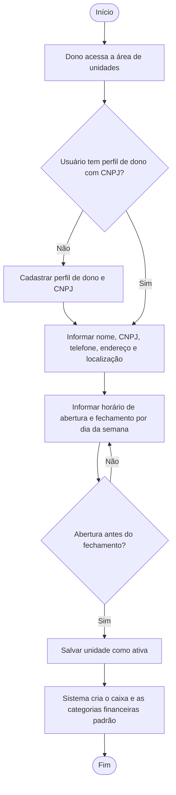

### 10.2 PN4 — Agendamento

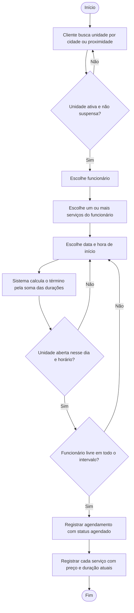

### 10.3 PN5 — Atendimento, pagamento e comissão

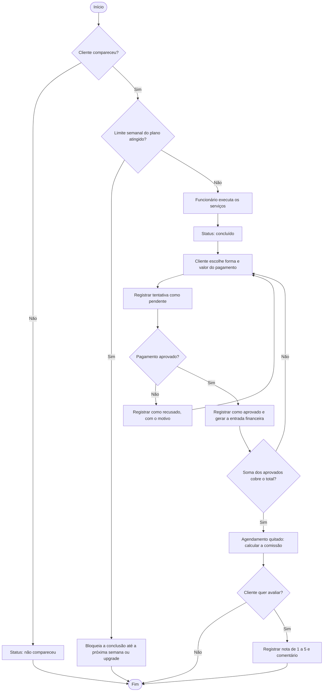

### 10.4 PN9 — Limite semanal do plano

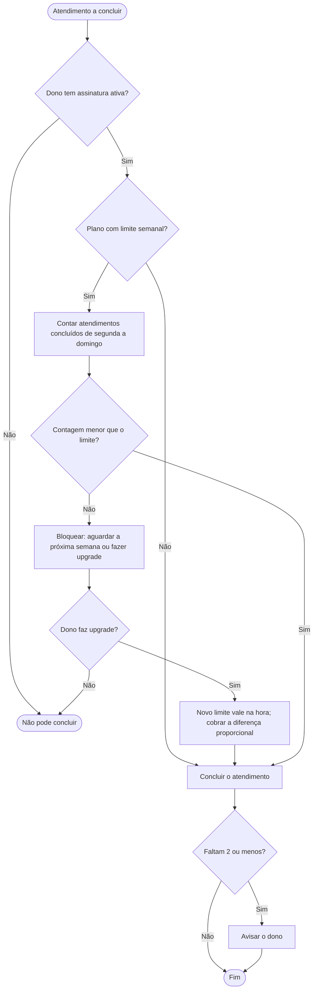

### 10.5 PN9 — Mensalidade e inadimplência

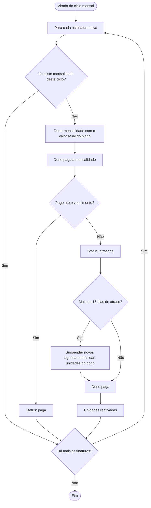

### 10.6 PN11 — Fechamento de comissões

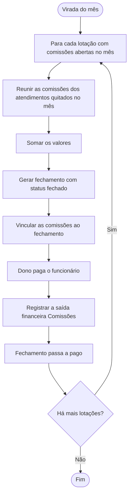

### 10.7 PN10 — Gestão financeira do salão

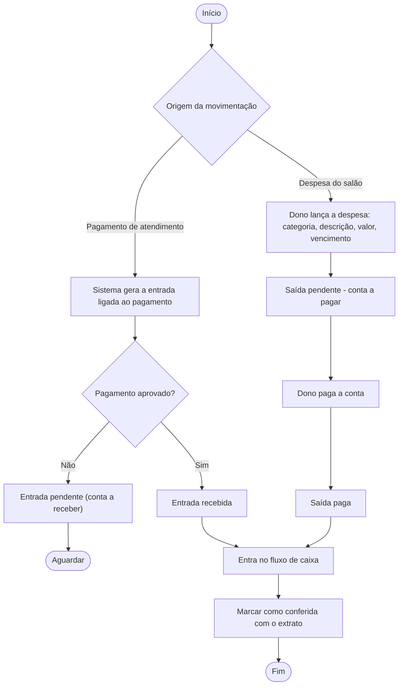

### 10.8 Integração entre os processos

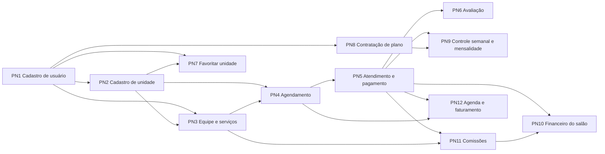

---

## 11. Entidades

São 23 entidades no DER. Dois relacionamentos N:N viram tabelas próprias no modelo lógico (ITEM_AGENDAMENTO e FAVORITO), o que totaliza 25 tabelas.

| Entidade | Por que existe | Origem |
|---|---|---|
| **USUARIO** | Cadastro único de qualquer pessoa que usa o sistema, para evitar duplicidade entre unidades. | P3, RF01, RN01 |
| **CLIENTE** | Perfil de quem agenda serviços; especialização de USUARIO. | RF02, RF07 |
| **FUNCIONARIO** | Perfil de quem executa serviços; especialização de USUARIO. | RF05, RN06 |
| **CONTA_PROFISSIONAL** (dono) | Perfil de quem é dono de unidades, contrata o plano e paga a plataforma; especialização de USUARIO. | RF03, RN03 |
| **SALAO** | Cada unidade física, com CNPJ, endereço, contato e localização. | RF03, RN04 |
| **HORARIO_FUNCIONAMENTO** | Horário de cada unidade em cada dia da semana. Entidade fraca de SALAO. | P2, RF04, RN05 |
| **LOTACAO** | Período em que um funcionário atua em uma unidade; guarda o histórico de transferências. | P13, RF05, RN06 |
| **SERVICO** | O que o funcionário oferece, com preço e duração próprios. | RF06, RN07 |
| **AGENDAMENTO** | A reserva de um horário: une cliente, funcionário e unidade (pela lotação). | P1, RF07, RN09 |
| **PAGAMENTO** | Cada tentativa de pagamento de um agendamento concluído, aprovada ou não. | P5, P14, RF13, RN19 |
| **AVALIACAO** | A opinião do cliente sobre um atendimento. | P7, RF15, RN23 |
| **PLANO** | Cada modalidade da plataforma, com preço mensal e limite semanal. | P10, RF20, RN25 |
| **ASSINATURA** | O plano contratado pelo dono, com início, renovação e situação. | P10, RF21, RN26 |
| **HISTORICO_ASSINATURA** | Registro das contratações e trocas de plano ao longo do tempo. | RF21, RN31 |
| **CICLO_SEMANAL** | Uma semana de uso do plano, com o limite aplicado e a quantidade apurada. | P10, RF22, RN27 |
| **AJUSTE_MENSALIDADE** | Correção posterior ao fechamento de uma semana, sem sobrescrever o original. | P16, RF24, RN33 |
| **MENSALIDADE** | A cobrança mensal da plataforma para cada assinatura. | P10, RF25, RN34 |
| **CONTA_FINANCEIRA** | Onde o salão movimenta dinheiro (caixa, banco, conta digital). | P12, RF29 |
| **CATEGORIA_FINANCEIRA** | Tipos de receita e de despesa de cada salão, escolhidos ao lançar o valor. | P12, RF27, RN37 |
| **LANCAMENTO_FINANCEIRO** | Cada entrada e saída do salão, com situação e conferência. Cobre contas a pagar e a receber. | P12, RF27 a RF30, RN37 a RN45 |
| **REGRA_COMISSAO** | Percentual de comissão de um funcionário em um período. Entidade fraca de FUNCIONARIO. | P11, RF31, RN46 |
| **COMISSAO** | Resultado do cálculo de um atendimento quitado, com percentual e base copiados. | P11, RF32, RN47 |
| **FECHAMENTO_COMISSAO** | Soma das comissões de uma lotação em um mês, com a data do pagamento. | P11, RF33, RN49 |

**Substantivos que não viraram entidade:**

- *Item do agendamento* virou o relacionamento **contém** entre AGENDAMENTO e SERVICO, com atributos próprios (seção 13).
- *Favorito* virou o relacionamento **favorita** entre CLIENTE e SALAO, com a data em que foi favoritado.
- *Endereço* e *localização* viraram atributos compostos de SALAO, porque não são compartilhados entre unidades.
- *Faturamento* e *renda* não viraram entidade: são consultas sobre PAGAMENTO (RN22).
- *Categoria de despesa* deixou de ser atributo e virou a entidade CATEGORIA_FINANCEIRA, para que cada salão tenha a sua lista.
- *Faixa de mensalidade* deixou de existir: o preço agora vem do plano contratado.

---

## 12. Atributos

Classificação usada: **identificador** (identifica a ocorrência), **chave parcial** (identifica junto com a entidade dona), **simples**, **composto** (formado por outros atributos), **derivado** (calculado a partir de outros dados), **obrigatório** ou **opcional**. Não há atributos multivalorados: os horários por dia, que seriam o candidato, foram modelados como entidade fraca.

| Entidade | Atributos |
|---|---|
| USUARIO | **id_usuario** (identificador); nome, email, senha_hash, data_cadastro, ativo (simples, obrigatórios); telefone (simples, opcional) |
| CLIENTE | herda id_usuario; data_nascimento (simples, opcional) |
| FUNCIONARIO | herda id_usuario; cpf, especialidade, data_admissao, ativo (simples, obrigatórios); renda_mensal (derivado) |
| CONTA_PROFISSIONAL | herda id_usuario; cnpj (simples, obrigatório, único) |
| SALAO | **id_salao** (identificador); nome, cnpj, ativo, suspenso (simples, obrigatórios); telefone (simples, opcional); endereco (composto: cep, logradouro, numero, bairro, cidade, uf); localizacao (composto: latitude, longitude); renda_mensal (derivado) |
| HORARIO_FUNCIONAMENTO | **dia_semana** (chave parcial); hora_abertura, hora_fechamento (simples, obrigatórios) |
| LOTACAO | **id_lotacao** (identificador); data_inicio (simples, obrigatório); data_fim (simples, vazio enquanto em vigor) |
| SERVICO | **id_servico** (identificador); nome, preco, duracao_min, ativo (simples, obrigatórios); descricao (simples, opcional) |
| AGENDAMENTO | **id_agendamento** (identificador); data_hora_inicio, status, criado_em (simples, obrigatórios); data_hora_fim (obrigatório, calculado na marcação pela RN13 e armazenado); observacao (simples, opcional) |
| PAGAMENTO | **id_pagamento** (identificador); valor, forma_pagamento, status, data_tentativa (simples, obrigatórios); data_aprovacao (preenchida na aprovação); motivo_recusa (preenchido na recusa) |
| AVALIACAO | **id_avaliacao** (identificador); nota, data_avaliacao (simples, obrigatórios); comentario (simples, opcional) |
| PLANO | **id_plano** (identificador); nome, preco, ilimitado, ativo (simples, obrigatórios); limite_semanal (simples, vazio no plano ilimitado) |
| ASSINATURA | **id_assinatura** (identificador); data_inicio, data_renovacao, status (simples, obrigatórios); data_fim (simples, opcional) |
| HISTORICO_ASSINATURA | **id_historico** (identificador); tipo, data_alteracao (simples, obrigatórios); valor_diferenca (simples, preenchido no upgrade) |
| CICLO_SEMANAL | **id_ciclo** (identificador); semana_inicio, semana_fim, status (simples, obrigatórios); limite_aplicavel (simples, vazio no plano ilimitado); qtd_apurada, data_fechamento (preenchidos no fechamento) |
| AJUSTE_MENSALIDADE | **id_ajuste** (identificador); tipo, quantidade_anterior, quantidade_corrigida, justificativa, data_ajuste (simples, obrigatórios) |
| MENSALIDADE | **id_mensalidade** (identificador); ciclo_inicio, ciclo_fim, valor_plano, valor_upgrade, data_vencimento, status (simples, obrigatórios); valor_total (derivado); data_pagamento, forma_pagamento (preenchidos no pagamento) |
| CONTA_FINANCEIRA | **id_conta** (identificador); nome, tipo (simples, obrigatórios) |
| CATEGORIA_FINANCEIRA | **id_categoria** (identificador); nome, tipo (simples, obrigatórios) |
| LANCAMENTO_FINANCEIRO | **id_lancamento** (identificador); descricao, tipo, valor, vencimento, status, conferido (simples, obrigatórios); natureza (fixa ou variável, só em despesa); data_pagamento (preenchida quando realizado); boleto_codigo (opcional) |
| REGRA_COMISSAO | **vigencia_inicio** (chave parcial); percentual (simples, obrigatório); vigencia_fim (simples, vazio = regra vigente) |
| COMISSAO | **id_comissao** (identificador); percentual_aplicado, valor_base, data_calculo (simples, obrigatórios); valor_comissao (derivado) |
| FECHAMENTO_COMISSAO | **id_fechamento** (identificador); mes_referencia, data_fechamento, status (simples, obrigatórios); valor_total (derivado); data_pagamento (vazia até pagar) |
| contém (relacionamento) | preco_cobrado, duracao_min (simples, obrigatórios) |
| favorita (relacionamento) | data_favoritado (simples, obrigatório) |

---

## 13. Relacionamentos

| Relacionamento | Entidades | Leitura | Atributos próprios | Regra |
|---|---|---|---|---|
| é um (especialização) | USUARIO → CLIENTE, FUNCIONARIO, CONTA_PROFISSIONAL | Um usuário pode ser cliente, funcionário e/ou dono | — | RN02 |
| possui | CONTA_PROFISSIONAL — SALAO | O dono possui unidades | — | RN04 |
| funciona *(identificador)* | SALAO — HORARIO_FUNCIONAMENTO | A unidade funciona em determinados dias e horários | — | RN05 |
| favorita | CLIENTE — SALAO | O cliente favorita unidades | data_favoritado | RN24 |
| emprega | SALAO — LOTACAO | A unidade tem funcionários lotados | — | RN06 |
| atua em | FUNCIONARIO — LOTACAO | O funcionário atua em unidades ao longo do tempo | — | RN06 |
| atende | LOTACAO — AGENDAMENTO | O funcionário, na unidade, atende agendamentos | — | RN09, RN11 |
| realiza | CLIENTE — AGENDAMENTO | O cliente realiza agendamentos | — | RN09 |
| oferece | FUNCIONARIO — SERVICO | O funcionário oferece serviços | — | RN07 |
| contém | AGENDAMENTO — SERVICO | O agendamento contém serviços | preco_cobrado, duracao_min | RN10, RN12 |
| gera | AGENDAMENTO — PAGAMENTO | O agendamento gera tentativas de pagamento | — | RN18, RN19, RN20 |
| avalia | AGENDAMENTO — AVALIACAO | O agendamento é avaliado em uma avaliação | — | RN23 |
| contrata | CONTA_PROFISSIONAL — ASSINATURA | O dono contrata assinaturas | — | RN26 |
| do plano | PLANO — ASSINATURA | A assinatura é de um plano | — | RN25 |
| registra | ASSINATURA — HISTORICO_ASSINATURA | A assinatura registra suas mudanças | — | RN31 |
| controla | ASSINATURA — CICLO_SEMANAL | A assinatura controla o uso semana a semana | — | RN27, RN28 |
| é corrigido por | CICLO_SEMANAL — AJUSTE_MENSALIDADE | Um ciclo fechado é corrigido por ajustes | — | RN33 |
| refere-se a | AJUSTE_MENSALIDADE — AGENDAMENTO | O ajuste pode se referir a um atendimento | — | RN33 |
| é responsável por | USUARIO — AJUSTE_MENSALIDADE | Quem registrou o ajuste | — | RN33 |
| cobra | ASSINATURA — MENSALIDADE | A assinatura gera mensalidades | — | RN34 |
| tem | SALAO — LANCAMENTO_FINANCEIRO | O salão tem movimentações financeiras | — | RN37 |
| movimenta em | SALAO — CONTA_FINANCEIRA | O salão movimenta dinheiro em contas | — | RN37 |
| define | SALAO — CATEGORIA_FINANCEIRA | O salão define suas categorias | — | RN37 |
| recebe | CONTA_FINANCEIRA — LANCAMENTO_FINANCEIRO | A conta recebe movimentações | — | RN37 |
| classifica | CATEGORIA_FINANCEIRA — LANCAMENTO_FINANCEIRO | A categoria classifica movimentações | — | RN38 |
| gera entrada | PAGAMENTO — LANCAMENTO_FINANCEIRO | Um pagamento gera uma entrada | — | RN40 |
| paga | LANCAMENTO_FINANCEIRO — FECHAMENTO_COMISSAO | A saída paga um fechamento | — | RN50 |
| compõe | FECHAMENTO_COMISSAO — COMISSAO | O fechamento reúne comissões | — | RN49 |
| tem fechamento | LOTACAO — FECHAMENTO_COMISSAO | A lotação tem um fechamento por mês | — | RN49 |
| gera comissão | AGENDAMENTO — COMISSAO | O atendimento quitado gera comissão | — | RN47 |
| tem regra *(identificador)* | FUNCIONARIO — REGRA_COMISSAO | O funcionário tem regras de comissão no tempo | — | RN46 |

**Verificação de N:N:**

- **AGENDAMENTO e SERVICO.** Um agendamento pode ter vários serviços (corte + barba) e um serviço aparece em vários agendamentos. É **N:N**, e o relacionamento tem atributos próprios.
- **CLIENTE e SALAO** (favorita). Um cliente favorita várias unidades e uma unidade é favoritada por vários clientes. É **N:N**.
- **FUNCIONARIO e SALAO** (trabalha em). Um funcionário pode atuar em várias unidades ao longo do tempo e uma unidade tem vários funcionários. É **N:N com período**, e por isso virou a entidade associativa **LOTACAO**.
- **CONTA_PROFISSIONAL e PLANO** (contrata). Um dono pode ter vários planos ao longo do tempo e um plano é contratado por vários donos. É **N:N com período**, e por isso virou a entidade associativa **ASSINATURA**.
- **Os demais relacionamentos não são N:N.**

**Atributos de relacionamento:**

- `preco_cobrado` e `duracao_min` descrevem **o serviço dentro daquele agendamento**, e não o serviço em si (que pode mudar de preço depois) nem o agendamento em si (que tem vários serviços).
- `data_favoritado` descreve **o ato de favoritar**, e não o cliente nem a unidade.

---

## 14. Cardinalidades

Notação **(mínimo, máximo)**: o par ao lado de uma entidade diz com quantas ocorrências da outra entidade ela se relaciona. Cada linha foi analisada nos dois sentidos ("vá e volte"). **No desenho do DER**, o par fica escrito junto da entidade oposta (a cardinalidade é lida a partir da entidade oposta).

| Relacionamento | Ida | Volta | Resultado | Justificativa |
|---|---|---|---|---|
| possui | Um dono possui quantas unidades? **1 a N** | Uma unidade pertence a quantos donos? **1 e só 1** | CONTA_PROFISSIONAL (1,N) — SALAO (1,1) | O dono só existe como dono ao ter unidade; uma unidade tem um único responsável pelo CNPJ (RN04). |
| funciona | Uma unidade tem quantos horários? **1 a 7** | Um horário é de quantas unidades? **1 e só 1** | SALAO (1,7) — HORARIO (1,1) | Um horário por dia da semana; ao menos um dia aberto (RN05). |
| favorita | Um cliente favorita quantas unidades? **0 a N** | Uma unidade é favoritada por quantos clientes? **0 a N** | CLIENTE (0,N) — SALAO (0,N) | Lista livre de favoritos, sem repetição (RN24). |
| emprega | Uma unidade tem quantas lotações? **0 a N** | Uma lotação é de quantas unidades? **1 e só 1** | SALAO (0,N) — LOTACAO (1,1) | Unidade recém-aberta ainda sem equipe (RN06). |
| atua em | Um funcionário tem quantas lotações? **0 a N** | Uma lotação é de quantos funcionários? **1 e só 1** | FUNCIONARIO (0,N) — LOTACAO (1,1) | Funcionário recém-cadastrado ainda sem unidade (RN06). |
| atende | Uma lotação atende quantos agendamentos? **0 a N** | Um agendamento é atendido por quantas lotações? **1 e só 1** | LOTACAO (0,N) — AGENDAMENTO (1,1) | A agenda é por profissional e unidade (RN09, RN15). |
| realiza | Um cliente realiza quantos agendamentos? **0 a N** | Um agendamento é de quantos clientes? **1 e só 1** | CLIENTE (0,N) — AGENDAMENTO (1,1) | Cliente pode se cadastrar sem agendar (RN09). |
| oferece | Um funcionário oferece quantos serviços? **0 a N** | Um serviço é de quantos funcionários? **1 e só 1** | FUNCIONARIO (0,N) — SERVICO (1,1) | Preço e duração são do profissional (RN07). |
| contém | Um agendamento contém quantos serviços? **1 a N** | Um serviço está em quantos agendamentos? **0 a N** | AGENDAMENTO (1,N) — SERVICO (0,N) | Não existe agendamento vazio (RN10); serviço novo pode nunca ter sido agendado. |
| gera | Um agendamento gera quantas tentativas de pagamento? **0 a N** | Um pagamento é de quantos agendamentos? **1 e só 1** | AGENDAMENTO (0,N) — PAGAMENTO (1,1) | Sinal parcial, recusa e nova tentativa precisam de linhas próprias (RN19). |
| avalia | Um agendamento tem quantas avaliações? **0 a 1** | Uma avaliação é de quantos agendamentos? **1 e só 1** | AGENDAMENTO (0,1) — AVALIACAO (1,1) | Avaliar é opcional e única por atendimento (RN23). |
| contrata | Um dono contrata quantas assinaturas? **0 a N** | Uma assinatura é de quantos donos? **1 e só 1** | CONTA_PROFISSIONAL (0,N) — ASSINATURA (1,1) | Só uma ativa por vez, mas várias ao longo do tempo (RN26). |
| do plano | Um plano está em quantas assinaturas? **0 a N** | Uma assinatura é de quantos planos? **1 e só 1** | PLANO (0,N) — ASSINATURA (1,1) | A troca de plano é registrada no histórico (RN31). |
| registra | Uma assinatura registra quantas mudanças? **1 a N** | Um registro é de quantas assinaturas? **1 e só 1** | ASSINATURA (1,N) — HISTORICO (1,1) | A contratação já é o primeiro registro (RN31). |
| controla | Uma assinatura controla quantos ciclos? **0 a N** | Um ciclo é de quantas assinaturas? **1 e só 1** | ASSINATURA (0,N) — CICLO_SEMANAL (1,1) | Um ciclo por semana (RN27). |
| é corrigido por | Um ciclo tem quantos ajustes? **0 a N** | Um ajuste é de quantos ciclos? **1 e só 1** | CICLO_SEMANAL (0,N) — AJUSTE (1,1) | Só há ajuste quando houve erro (RN33). |
| refere-se a | Um atendimento tem quantos ajustes? **0 a N** | Um ajuste se refere a quantos atendimentos? **0 a 1** | AGENDAMENTO (0,N) — AJUSTE (0,1) | O ajuste nem sempre é sobre um atendimento específico (RN33). |
| é responsável por | Um usuário registra quantos ajustes? **0 a N** | Um ajuste é de quantos responsáveis? **1 e só 1** | USUARIO (0,N) — AJUSTE (1,1) | Todo ajuste tem responsável (RN33). |
| cobra | Uma assinatura gera quantas mensalidades? **0 a N** | Uma mensalidade é de quantas assinaturas? **1 e só 1** | ASSINATURA (0,N) — MENSALIDADE (1,1) | Uma por ciclo mensal (RN34). |
| tem | Um salão tem quantas movimentações? **0 a N** | Uma movimentação é de quantos salões? **1 e só 1** | SALAO (0,N) — LANCAMENTO (1,1) | Cada salão enxerga só as suas (RN37, RN45). |
| movimenta em | Um salão tem quantas contas financeiras? **0 a N** | Uma conta é de quantos salões? **1 e só 1** | SALAO (0,N) — CONTA_FINANCEIRA (1,1) | Cada salão tem o seu caixa (RN37). |
| define | Um salão define quantas categorias? **0 a N** | Uma categoria é de quantos salões? **1 e só 1** | SALAO (0,N) — CATEGORIA (1,1) | Cada salão tem a sua lista (RN37). |
| recebe | Uma conta recebe quantas movimentações? **0 a N** | Uma movimentação usa quantas contas? **1 e só 1** | CONTA_FINANCEIRA (0,N) — LANCAMENTO (1,1) | Toda movimentação acontece em alguma conta (RN37). |
| classifica | Uma categoria classifica quantas movimentações? **0 a N** | Uma movimentação tem quantas categorias? **1 e só 1** | CATEGORIA (0,N) — LANCAMENTO (1,1) | Toda movimentação tem categoria do mesmo tipo (RN38). |
| gera entrada | Um pagamento gera quantas entradas? **0 a 1** | Uma entrada vem de quantos pagamentos? **0 a 1** | PAGAMENTO (0,1) — LANCAMENTO (0,1) | Recusado não gera entrada; despesa não vem de pagamento (RN40). |
| paga | Uma saída paga quantos fechamentos? **0 a 1** | Um fechamento é pago por quantas saídas? **0 a 1** | LANCAMENTO (0,1) — FECHAMENTO (0,1) | Só vira saída depois que o dono paga o funcionário (RN50). |
| compõe | Um fechamento reúne quantas comissões? **1 a N** | Uma comissão está em quantos fechamentos? **0 a 1** | FECHAMENTO (1,N) — COMISSAO (0,1) | Comissão recém-gerada ainda não está em nenhum fechamento (RN49). |
| tem fechamento | Uma lotação tem quantos fechamentos? **0 a N** | Um fechamento é de quantas lotações? **1 e só 1** | LOTACAO (0,N) — FECHAMENTO (1,1) | Um por mês e por lotação (RN49). |
| gera comissão | Um atendimento gera quantas comissões? **0 a 1** | Uma comissão é de quantos atendimentos? **1 e só 1** | AGENDAMENTO (0,1) — COMISSAO (1,1) | Só o atendimento quitado, de funcionário com regra vigente (RN47). |
| tem regra | Um funcionário tem quantas regras? **0 a N** | Uma regra é de quantos funcionários? **1 e só 1** | FUNCIONARIO (0,N) — REGRA_COMISSAO (1,1) | Quem não recebe comissão não tem regra; as regras se sucedem no tempo (RN46). |

**Especialização:** parcial (pode existir usuário sem perfil, RN02) e sobreposta (o mesmo usuário pode ser cliente e funcionário, por exemplo uma manicure que também corta o cabelo em outra unidade).

---

## 15. Dicionário de dados conceitual

Os domínios abaixo são conceituais; os tipos físicos, tamanhos, restrições e valores padrão estão no modelo lógico e no script SQL.

### USUARIO

| Atributo | Descrição | Domínio | Regra / Observação |
|---|---|---|---|
| id_usuario | Identificador do usuário | Número sequencial | Identificação única |
| nome | Nome completo | Texto até 100 | Obrigatório |
| email | E-mail de acesso | Texto até 100 | Obrigatório; não pode ser duplicado (RN01) |
| telefone | Telefone de contato | Texto até 20 | Opcional |
| senha_hash | Senha criptografada | Texto até 255 | Nunca em texto aberto (RNF01) |
| data_cadastro | Momento do cadastro | Data e hora | Preenchido automaticamente (RNF08) |
| ativo | Indica se o usuário está ativo | Sim / Não | Desativação no lugar de exclusão (RN08) |

### CLIENTE

| Atributo | Descrição | Domínio | Regra / Observação |
|---|---|---|---|
| id_usuario | Usuário que tem o perfil de cliente | Herdado de USUARIO | Um perfil de cliente por usuário |
| data_nascimento | Data de nascimento | Data | Opcional |

### FUNCIONARIO

| Atributo | Descrição | Domínio | Regra / Observação |
|---|---|---|---|
| id_usuario | Usuário que tem o perfil de funcionário | Herdado de USUARIO | Um perfil de funcionário por usuário |
| cpf | CPF do funcionário | 11 dígitos | Obrigatório; não pode ser duplicado (RN01) |
| especialidade | Área principal de atuação | Texto até 60 | Obrigatório; ex.: cabeleireiro, barbeiro, manicure |
| data_admissao | Data de entrada | Data | Obrigatório |
| ativo | Indica se ainda trabalha | Sim / Não | Funcionário desligado mantém histórico (RN08) |
| renda_mensal | Quanto o funcionário faturou no mês | Valor em R$ | Derivado: soma dos pagamentos aprovados dos atendimentos dele no mês |

### CONTA_PROFISSIONAL (dono)

| Atributo | Descrição | Domínio | Regra / Observação |
|---|---|---|---|
| id_usuario | Usuário que tem o perfil de dono | Herdado de USUARIO | Um perfil de dono por usuário |
| cnpj | CNPJ do dono | 14 dígitos | Obrigatório; não pode ser duplicado (RN03) |

### SALAO

| Atributo | Descrição | Domínio | Regra / Observação |
|---|---|---|---|
| id_salao | Identificador da unidade | Número sequencial | Identificação única |
| nome | Nome da unidade | Texto até 100 | Obrigatório |
| cnpj | CNPJ da unidade | 14 dígitos | Obrigatório; único (RN03) |
| telefone | Telefone da unidade | Texto até 20 | Opcional |
| endereco | Endereço da unidade | Composto | cep (8 dígitos), logradouro, numero, bairro, cidade, uf (2 letras) |
| localizacao | Coordenadas geográficas | Composto | latitude e longitude com 6 casas decimais; usadas na busca por proximidade (RF17) |
| ativo | Indica se a unidade aceita agendamentos | Sim / Não | Desativação no lugar de exclusão (RN08) |
| suspenso | Indica suspensão por inadimplência | Sim / Não | Bloqueia novos agendamentos (RN35) |
| renda_mensal | Quanto a unidade faturou no mês | Valor em R$ | Derivado: soma dos pagamentos aprovados dos atendimentos da unidade no mês |

### HORARIO_FUNCIONAMENTO

| Atributo | Descrição | Domínio | Regra / Observação |
|---|---|---|---|
| dia_semana | Dia da semana | 0 (domingo) a 6 (sábado) | Chave parcial; um por dia em cada unidade (RN05) |
| hora_abertura | Hora em que a unidade abre | Hora | Obrigatório; anterior ao fechamento |
| hora_fechamento | Hora em que a unidade fecha | Hora | Obrigatório |

### LOTACAO

| Atributo | Descrição | Domínio | Regra / Observação |
|---|---|---|---|
| id_lotacao | Identificador da lotação | Número sequencial | Identificação única |
| data_inicio | Início da atuação na unidade | Data | Obrigatório |
| data_fim | Fim da atuação na unidade | Data | Vazia enquanto em vigor; dois períodos do mesmo funcionário não se sobrepõem (RN06) |

### SERVICO

| Atributo | Descrição | Domínio | Regra / Observação |
|---|---|---|---|
| id_servico | Identificador do serviço | Número sequencial | Identificação única |
| nome | Nome do serviço | Texto até 100 | Obrigatório; ex.: corte masculino |
| descricao | Detalhes do serviço | Texto livre | Opcional |
| preco | Preço atual | Valor em R$, 2 casas | Obrigatório; maior que zero |
| duracao_min | Duração atual em minutos | Número inteiro | Obrigatório; maior que zero |
| ativo | Indica se o serviço pode ser agendado | Sim / Não | Serviço desativado mantém histórico (RN08) |

### AGENDAMENTO

| Atributo | Descrição | Domínio | Regra / Observação |
|---|---|---|---|
| id_agendamento | Identificador do agendamento | Número sequencial | Identificação única |
| data_hora_inicio | Início do atendimento | Data e hora | Dentro do horário da unidade (RN14) |
| data_hora_fim | Término previsto | Data e hora | Início + soma das durações (RN13) |
| status | Situação do agendamento | agendado, confirmado, concluído, cancelado, não compareceu | Obrigatório |
| observacao | Pedido especial do cliente | Texto livre | Opcional |
| criado_em | Momento em que foi marcado | Data e hora | Preenchido automaticamente (RNF08) |

### contém (AGENDAMENTO × SERVICO)

| Atributo | Descrição | Domínio | Regra / Observação |
|---|---|---|---|
| preco_cobrado | Preço do serviço neste agendamento | Valor em R$, 2 casas | Copiado do serviço na marcação (RN12) |
| duracao_min | Duração do serviço neste agendamento | Número inteiro | Copiada do serviço na marcação (RN12) |

### PAGAMENTO

| Atributo | Descrição | Domínio | Regra / Observação |
|---|---|---|---|
| id_pagamento | Identificador da tentativa | Número sequencial | Identificação única |
| valor | Quantia desta tentativa | Valor em R$, 2 casas | Maior que zero; a soma dos aprovados não passa do total (RN20) |
| forma_pagamento | Meio de pagamento | dinheiro, pix, débito, crédito | Obrigatório (RN21) |
| status | Situação da tentativa | pendente, aprovado, recusado, estornado | Só aprovados entram no faturamento (RN22) |
| data_tentativa | Momento do registro | Data e hora | Preenchido automaticamente (RNF08) |
| data_aprovacao | Momento da aprovação | Data e hora | Vazia enquanto não aprovado |
| motivo_recusa | Por que foi recusada | Texto até 100 | Preenchido só quando recusado |

### AVALIACAO

| Atributo | Descrição | Domínio | Regra / Observação |
|---|---|---|---|
| id_avaliacao | Identificador da avaliação | Número sequencial | Identificação única |
| nota | Nota do atendimento | Inteiro de 1 a 5 | Obrigatório (RN23) |
| comentario | Texto do cliente | Texto livre | Opcional; não editável por terceiros (PO06) |
| data_avaliacao | Momento da avaliação | Data e hora | Posterior à conclusão do atendimento |

### favorita (CLIENTE × SALAO)

| Atributo | Descrição | Domínio | Regra / Observação |
|---|---|---|---|
| data_favoritado | Quando o cliente favoritou a unidade | Data e hora | Um favorito por par cliente-unidade (RN24) |

### PLANO

| Atributo | Descrição | Domínio | Regra / Observação |
|---|---|---|---|
| id_plano | Identificador do plano | Número sequencial | Identificação única |
| nome | Nome do plano | Texto até 30 | Obrigatório; único (Inicial, Intermediário, Ilimitado) |
| preco | Preço mensal | Valor em R$, 2 casas | Maior que zero (RN25) |
| limite_semanal | Atendimentos concluídos por semana | Número inteiro | Vazio no plano ilimitado (RN25) |
| ilimitado | Indica plano sem limite semanal | Sim / Não | Coerente com limite_semanal vazio |
| ativo | Indica se o plano pode ser contratado | Sim / Não | Plano desativado mantém histórico |

### ASSINATURA

| Atributo | Descrição | Domínio | Regra / Observação |
|---|---|---|---|
| id_assinatura | Identificador da assinatura | Número sequencial | Identificação única |
| data_inicio | Data da contratação | Data | Início do ciclo mensal (RN26) |
| data_renovacao | Próxima cobrança mensal | Data | Posterior ao início |
| data_fim | Data de encerramento | Data | Opcional |
| status | Situação | ativa, cancelada | Uma ativa por dono (RN26) |

### HISTORICO_ASSINATURA

| Atributo | Descrição | Domínio | Regra / Observação |
|---|---|---|---|
| id_historico | Identificador do registro | Número sequencial | Identificação única |
| tipo | Tipo da mudança | contratação, upgrade, downgrade, cancelamento | Obrigatório |
| valor_diferenca | Diferença cobrada no upgrade | Valor em R$, 2 casas | Proporcional aos dias que faltam no ciclo (RN31) |
| data_alteracao | Momento da mudança | Data e hora | Preenchido automaticamente |

### CICLO_SEMANAL

| Atributo | Descrição | Domínio | Regra / Observação |
|---|---|---|---|
| id_ciclo | Identificador do ciclo | Número sequencial | Identificação única |
| semana_inicio | Primeiro dia da semana | Data | Sempre uma segunda-feira (RN27) |
| semana_fim | Último dia da semana | Data | Domingo, seis dias depois do início |
| limite_aplicavel | Limite do plano na semana | Número inteiro | Vazio no plano ilimitado; atualizado no upgrade (RN31) |
| qtd_apurada | Atendimentos concluídos na semana | Número inteiro | Preenchida no fechamento (RN32) |
| status | Situação do ciclo | aberto, fechado | Fechado não muda (RN32) |
| data_fechamento | Momento do fechamento | Data e hora | Obrigatória quando fechado |

### AJUSTE_MENSALIDADE

| Atributo | Descrição | Domínio | Regra / Observação |
|---|---|---|---|
| id_ajuste | Identificador do ajuste | Número sequencial | Identificação única |
| tipo | Tipo da correção | inclusão, exclusão, correção | Obrigatório |
| quantidade_anterior | Quantidade apurada antes | Número inteiro | Mantém o resultado original |
| quantidade_corrigida | Quantidade depois da correção | Número inteiro | Obrigatório |
| justificativa | Motivo da correção | Texto livre | Obrigatória, não vazia (RN33) |
| data_ajuste | Momento do registro | Data e hora | Preenchido automaticamente |

### MENSALIDADE

| Atributo | Descrição | Domínio | Regra / Observação |
|---|---|---|---|
| id_mensalidade | Identificador da mensalidade | Número sequencial | Identificação única |
| ciclo_inicio | Início do ciclo cobrado | Data | Uma mensalidade por assinatura e ciclo (RN34) |
| ciclo_fim | Fim do ciclo cobrado | Data | Posterior ao início |
| valor_plano | Preço do plano na geração | Valor em R$, 2 casas | Copiado do plano (RN34) |
| valor_upgrade | Diferença proporcional de upgrade | Valor em R$, 2 casas | Zero se não houve upgrade no ciclo |
| valor_total | Total a pagar | Valor em R$, 2 casas | Derivado: valor_plano + valor_upgrade |
| data_vencimento | Data limite de pagamento | Data | Conforme PO07 |
| data_pagamento | Data em que o dono pagou | Data | Vazia enquanto pendente |
| forma_pagamento | Meio usado pelo dono | dinheiro, pix, débito, crédito, boleto | Preenchido no pagamento |
| status | Situação da cobrança | pendente, paga, atrasada | Obrigatório (RN35) |

### CONTA_FINANCEIRA

| Atributo | Descrição | Domínio | Regra / Observação |
|---|---|---|---|
| id_conta | Identificador da conta | Número sequencial | Identificação única |
| nome | Nome da conta | Texto até 60 | Único em cada salão; o salão nasce com "Caixa" |
| tipo | Tipo da conta | caixa, banco, digital | Obrigatório |

### CATEGORIA_FINANCEIRA

| Atributo | Descrição | Domínio | Regra / Observação |
|---|---|---|---|
| id_categoria | Identificador da categoria | Número sequencial | Identificação única |
| nome | Nome da categoria | Texto até 60 | Único em cada salão e tipo |
| tipo | Receita ou despesa | ENTRADA, SAIDA | Obrigatório (RN38) |

Categorias criadas para cada salão: **despesas** — Aluguel, Água e energia, Internet, Produtos de higiene, Materiais de trabalho, Salários, Comissões, Impostos, Manutenção de equipamentos, Marketing e Outros; **receitas** — Serviços e Outras receitas. O dono escolhe a categoria ao lançar o valor.

### LANCAMENTO_FINANCEIRO

| Atributo | Descrição | Domínio | Regra / Observação |
|---|---|---|---|
| id_lancamento | Identificador da movimentação | Número sequencial | Identificação única |
| descricao | O que foi pago ou recebido | Texto até 150 | Obrigatório (RN39) |
| tipo | Entrada ou saída | ENTRADA, SAIDA | Obrigatório (RN38) |
| natureza | Despesa fixa ou variável | fixa, variável | Só em saída |
| valor | Valor da movimentação | Valor em R$, 2 casas | Maior que zero |
| vencimento | Data prevista | Data | Obrigatório |
| data_pagamento | Data em que foi recebida ou paga | Data | Obrigatória quando realizada |
| status | Situação | PENDENTE, RECEBIDO, PAGO, CANCELADO | Entrada: recebido; saída: pago (RN41) |
| conferido | Já conferida com o extrato | Sim / Não | Só se realizada (RN43) |
| boleto_codigo | Linha digitável do boleto gerado | Texto até 60 | Opcional |

### REGRA_COMISSAO

| Atributo | Descrição | Domínio | Regra / Observação |
|---|---|---|---|
| vigencia_inicio | Início da vigência | Data | Chave parcial (RN46) |
| vigencia_fim | Fim da vigência | Data | Vazia = regra vigente; períodos do mesmo funcionário não se sobrepõem |
| percentual | Percentual de comissão | 0 a 100, 2 casas | Obrigatório |

### COMISSAO

| Atributo | Descrição | Domínio | Regra / Observação |
|---|---|---|---|
| id_comissao | Identificador da comissão | Número sequencial | Identificação única |
| percentual_aplicado | Percentual usado no cálculo | 0 a 100, 2 casas | Copiado da regra vigente (RN47) |
| valor_base | Soma dos pagamentos aprovados | Valor em R$, 2 casas | Base do cálculo |
| valor_comissao | Comissão do atendimento | Valor em R$, 2 casas | Derivado: valor_base × percentual_aplicado |
| data_calculo | Momento do cálculo | Data e hora | Define o mês de competência |

### FECHAMENTO_COMISSAO

| Atributo | Descrição | Domínio | Regra / Observação |
|---|---|---|---|
| id_fechamento | Identificador do fechamento | Número sequencial | Identificação única |
| mes_referencia | Mês fechado | Data (dia 1) | Um por lotação e mês (RN49) |
| valor_total | Soma das comissões | Valor em R$, 2 casas | Derivado: soma de valor_comissao |
| data_fechamento | Quando foi fechado | Data | Obrigatória |
| data_pagamento | Quando o funcionário foi pago | Data | Vazia até pagar |
| status | Situação | fechado, pago | Obrigatório |

---

## 16. DER

### 16.1 Modelo conceitual — notação de Chen

O DER tem 23 entidades e 30 relacionamentos, mais a especialização de USUARIO. Para ficar legível, ele foi dividido em quatro módulos. As entidades com **borda tracejada** pertencem a outro módulo e aparecem só como referência.

**Módulo 1 — Usuários e perfis**

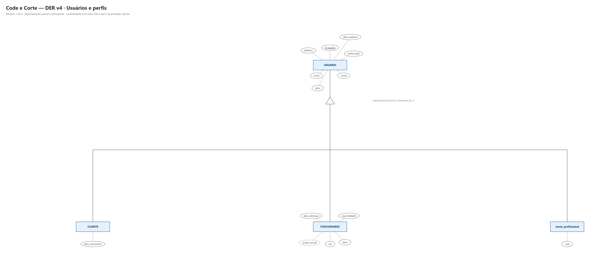

**Módulo 2 — Unidades, equipe e agenda**

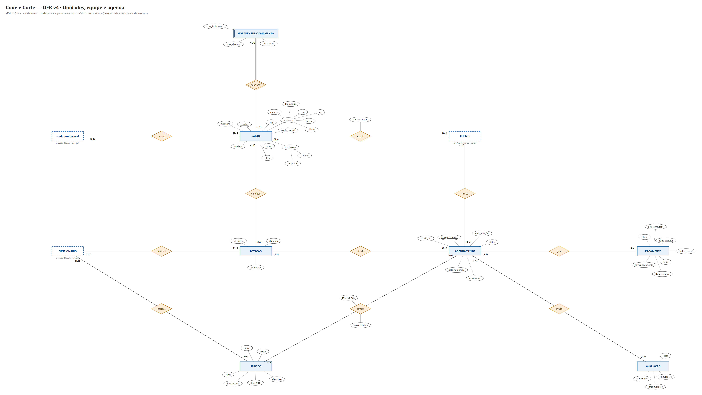

**Módulo 3 — Planos e mensalidade**

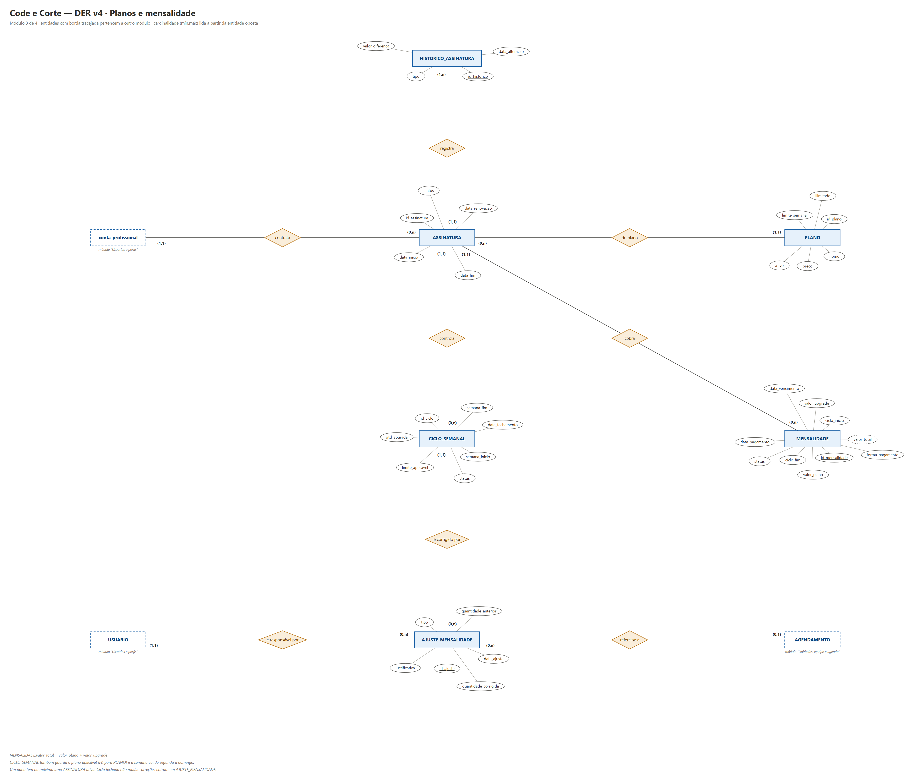

**Módulo 4 — Financeiro e comissões**

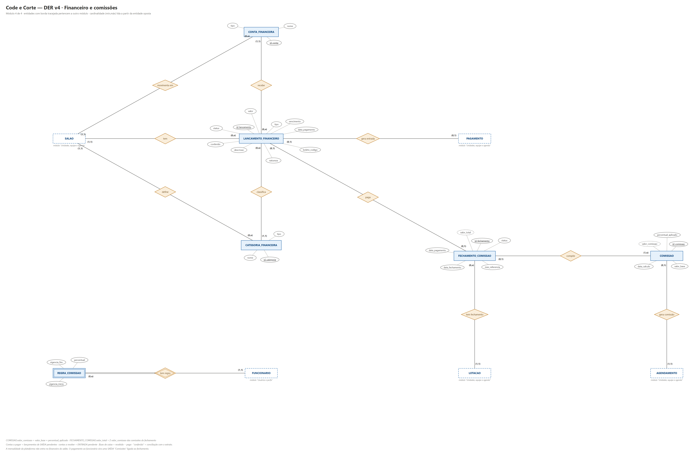

**Leitura do diagrama:**

- retângulo = entidade;
- retângulo duplo = entidade fraca (HORARIO_FUNCIONAMENTO e REGRA_COMISSAO);
- retângulo tracejado = entidade de outro módulo, só como referência;
- losango = relacionamento; losango duplo = relacionamento identificador;
- elipse sublinhada = identificador; sublinhado tracejado = chave parcial;
- elipse tracejada = atributo derivado;
- elipse com elipses ligadas = atributo composto (endereco, localizacao);
- linha dupla = ligação da entidade fraca ao relacionamento identificador;
- triângulo = especialização (p = parcial, s = sobreposta);
- (mín,máx) junto de uma entidade = cardinalidade lida a partir da entidade oposta.

**Fórmulas dos atributos derivados:**

| Atributo | Fórmula |
|---|---|
| FUNCIONARIO.renda_mensal | soma de PAGAMENTO.valor (aprovado) dos agendamentos atendidos por ele no mês |
| SALAO.renda_mensal | soma de PAGAMENTO.valor (aprovado) dos agendamentos feitos na unidade no mês |
| MENSALIDADE.valor_total | valor_plano + valor_upgrade |
| COMISSAO.valor_comissao | valor_base × percentual_aplicado |
| FECHAMENTO_COMISSAO.valor_total | soma de valor_comissao das comissões do fechamento |
| AGENDAMENTO.data_hora_fim | data_hora_inicio + soma de duracao_min dos itens (calculado na marcação e guardado) |

Os mesmos diagramas, em vetor, estão em [`docs/diagramas/`](docs/diagramas/) (arquivos `.svg`) e o arquivo do Figma tem a legenda completa. A versão anterior do DER (1ª entrega original) fica em [`docs/versao-anterior/`](docs/versao-anterior/) só como registro.

### 16.2 Modelo lógico de referência

O modelo lógico completo, com as 25 tabelas, as chaves e a conversão de cada relacionamento, está em [`docs/modelo-logico.md`](docs/modelo-logico.md) e na seção 20.

---

## 17. Justificativas técnicas

**J1 — USUARIO com especialização em vez de três cadastros separados.**
*Decisão:* uma entidade USUARIO com os subtipos CLIENTE, FUNCIONARIO e CONTA_PROFISSIONAL.
*Por quê:* o problema P3 é o cliente duplicado. Com um cadastro único, o e-mail aparece uma vez só (RN01).
*Regra:* RN02 diz que a mesma pessoa pode ter mais de um papel, por isso a especialização é **sobreposta**. Ela é **parcial** porque o usuário existe antes de escolher o perfil.

**J2 — HORARIO_FUNCIONAMENTO como entidade fraca, e não como atributo multivalorado.**
*Decisão:* entidade fraca com chave parcial dia_semana.
*Por quê:* cada dia tem dois dados próprios (abertura e fechamento), e a regra "um horário por dia" (RN05) precisa ser garantida pela identificação. A cardinalidade (1,7) vem direto do calendário.

**J3 — LOTACAO em vez de uma ligação fixa entre funcionário e unidade.**
*Decisão:* entidade associativa com período (data_inicio e data_fim) entre FUNCIONARIO e SALAO.
*Por quê:* o profissional muda de unidade (P13). Com uma ligação fixa, a transferência apagaria onde ele trabalhava e o faturamento por unidade ficaria errado. A lotação guarda cada período, e a regra de não estar em duas unidades ao mesmo tempo (RN06) fica protegida pelo banco.

**J4 — Serviço pertence ao funcionário, e não à unidade.**
*Decisão:* FUNCIONARIO (0,n) — oferece — SERVICO (1,1).
*Por quê:* na mesma unidade, profissionais cobram valores diferentes pelo "mesmo" corte e têm durações diferentes (PO03, RN07). Se o serviço fosse da unidade, preço e duração não representariam a realidade.

**J5 — Itens do agendamento como relacionamento N:N com atributos.**
*Decisão:* relacionamento **contém** com preco_cobrado e duracao_min.
*Por quê:* um atendimento costuma combinar serviços (corte + barba), o que torna o relacionamento N:N (RN10). O preço cobrado não é atributo de SERVICO, porque o preço muda com o tempo (P4), nem de AGENDAMENTO, porque cada serviço tem o seu. Ele descreve **o serviço naquele agendamento** (RN12). A participação total de AGENDAMENTO (1,n) impede agendamento vazio.

**J6 — Agendamento ligado à lotação, e não só ao funcionário.**
*Decisão:* AGENDAMENTO (1,1) — atende — LOTACAO.
*Por quê:* a lotação já identifica funcionário **e** unidade no período. Assim o agendamento guarda onde o atendimento realmente aconteceu mesmo depois de uma transferência, o que sustenta o faturamento por unidade (RF19) e a regra RN11 sem uma ligação a mais.

**J7 — Pagamento como registro de cada tentativa (0,n).**
*Decisão:* AGENDAMENTO (0,n) — gera — PAGAMENTO (1,1), sem unicidade em id_agendamento.
*Por quê:* com no máximo um pagamento por agendamento, uma tentativa recusada teria de ser sobrescrita pela seguinte (P14), e um pagamento dividido (parte em Pix, parte em dinheiro) não caberia. Cada tentativa vira uma linha, com status e motivo da recusa. O total a pagar não é guardado no pagamento: é a soma dos itens, em um só lugar. "Pago" e "parcialmente pago" são situações do agendamento, calculadas pela soma dos aprovados (RN19, RN20).

**J8 — Avaliação como entidade 1:1 opcional.**
*Decisão:* AGENDAMENTO (0,1) — avalia — AVALIACAO (1,1).
*Por quê:* nem todo agendamento é avaliado. Colocar nota e comentário em AGENDAMENTO deixaria muitos campos vazios, e a avaliação tem momento e regras próprias (RN23, PO06).

**J9 — Favorito como relacionamento N:N, e não como entidade.**
*Decisão:* relacionamento **favorita** com data_favoritado.
*Por quê:* o favorito não tem identidade própria; ele só existe como ligação entre um cliente e uma unidade (RN24).

**J10 — Plano, assinatura e ciclo semanal separados.**
*Decisão:* PLANO guarda as características de cada modalidade; ASSINATURA registra o plano que o dono contratou; CICLO_SEMANAL registra cada semana de uso.
*Por quê:* o ciclo de cobrança é mensal e o controle de uso é semanal (RN26, RN27). Separar as duas coisas permite renovar o limite toda segunda-feira sem mexer na data de cobrança. O fechamento da semana guarda uma fotografia (plano, limite, quantidade e data), e o histórico de trocas de plano fica em HISTORICO_ASSINATURA (RN31, RN32).

**J11 — Correção por ajuste, nunca por alteração.**
*Decisão:* AJUSTE_MENSALIDADE liga-se ao ciclo fechado, com tipo, justificativa, data e responsável.
*Por quê:* se a correção alterasse o ciclo, o resultado original se perderia (P16). Com o ajuste, é possível consultar o resultado original e o atualizado, e saber quem corrigiu e por quê (RN33).

**J12 — Mensalidade com o valor do plano copiado.**
*Decisão:* MENSALIDADE guarda valor_plano e valor_upgrade.
*Por quê:* se o preço do plano for reajustado, as mensalidades antigas não podem mudar (RN34). É a mesma lógica do preço cobrado em J5.

**J13 — Um único lançamento financeiro para entradas e saídas.**
*Decisão:* LANCAMENTO_FINANCEIRO com tipo (ENTRADA ou SAÍDA) e status, em vez de tabelas separadas de contas a pagar e a receber.
*Por quê:* contas a pagar são saídas pendentes e contas a receber são entradas pendentes. O fluxo de caixa soma só o que foi recebido e pago (RN42), e a conciliação ficou simples: um campo "conferido" em cada movimentação (RN43). Se no futuro for preciso importar extratos linha a linha, essa parte pode ser ampliada.

**J14 — Categorias e contas financeiras por salão.**
*Decisão:* CATEGORIA_FINANCEIRA e CONTA_FINANCEIRA pertencem a um salão, e o lançamento usa chaves compostas.
*Por quê:* cada salão tem a sua lista e não pode ver a de outro (RN37, RN45). A chave composta garante, no próprio banco, que categoria e conta são do mesmo salão do lançamento e que a categoria é do mesmo tipo.

**J15 — Comissão em três entidades.**
*Decisão:* REGRA_COMISSAO (percentual com vigência), COMISSAO (resultado de cada atendimento quitado) e FECHAMENTO_COMISSAO (soma mensal por lotação).
*Por quê:* o processo tem três momentos com dados diferentes: combinar o percentual, calcular cada atendimento e fechar e pagar o mês. O percentual é copiado para a comissão, então um reajuste não muda o passado (RN47). O fechamento aponta para a lotação, de modo que um funcionário transferido no meio do mês tem um fechamento por unidade.

**J16 — Desativação lógica (ativo) em vez de exclusão.**
*Decisão:* atributo ativo em USUARIO, FUNCIONARIO, SALAO e SERVICO; movimentações realizadas e ciclos fechados não são apagados.
*Por quê:* apagar um funcionário ou serviço apagaria ou quebraria o histórico de agendamentos e pagamentos, que é exatamente o problema que o sistema resolve (P4, P6, RN08, PO12).

**J17 — Endereço e localização como atributos compostos.**
*Decisão:* atributos compostos de SALAO.
*Por quê:* cada unidade tem o seu endereço, não compartilhado com outras. A latitude e a longitude sustentam a busca por proximidade (RF17). No modelo lógico, os compostos viram colunas simples.

---

## 18. Conclusão

A análise partiu de como um salão ou barbearia de pequeno porte funciona hoje: agenda em papel ou WhatsApp, preços sem histórico, pagamentos anotados à parte, comissões e faturamento somados à mão. Dessa realidade saíram:

- 16 problemas e 12 necessidades;
- 12 processos de negócio;
- 35 requisitos funcionais e 11 não funcionais;
- 50 regras de negócio e 13 políticas organizacionais.

O modelo conceitual tem 23 entidades e 30 relacionamentos, mais a especialização de USUARIO, e o modelo lógico tem 25 tabelas. Cada elemento é rastreável até uma regra ou um problema. Os pontos que exigiram mais decisão foram:

- o cadastro único de pessoas com especialização sobreposta;
- o histórico de lotação do funcionário, para preservar transferências;
- o preço cobrado registrado no relacionamento entre agendamento e serviço;
- os pagamentos como tentativas, com a quitação calculada pelos itens;
- os planos com controle semanal e correções por ajuste;
- a gestão financeira do salão e a comissão com percentual copiado.

---

## 19. Revisão da 1ª entrega: resposta à devolutiva

A 1ª entrega recebeu nota 7,5 ("atingido com inconsistências"). A tabela mostra o que foi feito em cada ponto da devolutiva.

| # | Ponto da devolutiva | O que foi feito | Onde ver |
|---|---|---|---|
| 1 | **Histórico de funcionários** (corrigir) | Criada a entidade associativa LOTACAO, com período de atuação. Transferir é encerrar uma lotação e abrir outra. O agendamento aponta para a lotação, então o histórico se preserva. | RN06, J3, J6, seção 20 |
| 2 | **Conflitos de horários** (aprimorar) | O banco recusa dois agendamentos do mesmo funcionário em horários sobrepostos, mesmo com pedidos simultâneos, e valida o horário da unidade e o período da lotação. **Férias, feriados e intervalos ainda não estão modelados.** | RN14, RN15, seção 20 |
| 3 | **Pagamentos** (aprimorar) | A cardinalidade passou de (0,1) para (0,N): cada tentativa é uma linha, com status e motivo da recusa. A limitação do 1:1 era não guardar tentativa recusada, nova tentativa nem pagamento parcial. | RN19, RN20, J7 |
| 4 | **Comissões** (corrigir) | Esclarecido que a plataforma não recebe comissão sobre os serviços; a comissão é do dono para o funcionário. Modelada em REGRA_COMISSAO, COMISSAO e FECHAMENTO_COMISSAO. | RN46 a RN50, J15 |
| 5 | **Gestão financeira** (corrigir) | Criados LANCAMENTO_FINANCEIRO, CATEGORIA_FINANCEIRA e CONTA_FINANCEIRA, que cobrem contas a pagar e a receber, fluxo de caixa e conciliação, no escopo do salão. | RN37 a RN45, J13, J14 |
| 6 | **Mensalidades** (aprimorar) | Planos com limite semanal. O fechamento de cada semana guarda a apuração e as correções posteriores viram ajustes com justificativa e responsável, sem sobrescrever o original. | RN25 a RN34, J10 a J12 |
| 7 | **Políticas organizacionais** (corrigir) | Definidos o prazo de cancelamento (2 horas), o vencimento da mensalidade (data de renovação do ciclo) e a suspensão por inadimplência (mais de 15 dias de atraso). | PO04, PO07 |
| 8 | **Documentação acadêmica** (corrigir) | Dados da equipe completos (nome e RGM), contribuição de cada integrante e este documento consolidado em PDF único. | Seção 1, `docs/colaboracao-integrantes.md` |

**Mudanças de decisão em relação ao DER lógico v2:** a tabela completa ("como era, como ficou, por que alteramos") está na seção 4 de [`docs/modelo-logico.md`](docs/modelo-logico.md). Entre elas: SALAO passou a ter identificador próprio, o CPF passou a ser só do funcionário, o valor do pagamento deixou de ser "total" e a mensalidade por faixas de clientes foi substituída pelos planos.

---

## 20. Modelo lógico e banco de dados

O banco foi implementado em **PostgreSQL** a partir do modelo lógico. O script [`sql/ddl/01_criar_banco_e_tabelas.sql`](sql/ddl/01_criar_banco_e_tabelas.sql) cria:

- **25 tabelas** com chaves primárias, chaves estrangeiras e restrições (únicos, verificações e exclusões de sobreposição);
- **14 gatilhos** que protegem regras de negócio: horário da unidade, serviço do funcionário, pagamento só após a conclusão, soma dos pagamentos dentro do total, limite semanal do plano, histórico de troca de plano, ciclo fechado imutável, comissão calculada na quitação e entrada financeira gerada pelo pagamento;
- **4 rotinas** para abrir e fechar a semana, aplicar a política de inadimplência e fechar as comissões do mês;
- **8 views** para os atributos derivados e para o financeiro (fluxo de caixa, contas a pagar e a receber, pendentes de conferência);
- os **3 planos** da plataforma como dados de domínio. Ao cadastrar uma unidade, o banco cria o caixa e as categorias financeiras padrão dela.

O script foi executado do zero em um banco vazio e passou em 98 verificações (conflito de horário, limite semanal, upgrade, pagamento parcial e recusado, comissão, financeiro, suspensão por inadimplência e transferência de funcionário). Como executar:

```bash
psql -U postgres -f sql/ddl/01_criar_banco_e_tabelas.sql
```

A conversão de cada relacionamento em tabela, as tabelas com suas chaves e a lista das regras protegidas pelo banco estão em [`docs/modelo-logico.md`](docs/modelo-logico.md).

**Estado da entrega final**

| Item | Situação |
|---|---|
| Revisão da 1ª entrega e DER atualizado | Concluído (seções 1 a 19) |
| Modelo lógico relacional | Concluído (`docs/modelo-logico.md`) |
| Script SQL: estrutura, restrições, gatilhos e views | Concluído e testado |
| Normalização (1FN, 2FN, 3FN) documentada | Em andamento |
| Dicionário de dados do banco implementado | Em andamento |
| Massa de dados, consultas gerenciais e de auditoria | Em andamento |
| Análise de BI e IA | Em andamento |

---

## 21. Organização do repositório

```text
code-e-corte-modelagem/
├── README.md                          este documento
├── docs/
│   ├── modelo-logico.md               modelo lógico, mudanças e regras protegidas pelo banco
│   ├── colaboracao-integrantes.md     integrantes, RGM e contribuições (e o PDF original)
│   ├── diagramas/                     DER v4 em PNG e SVG
│   ├── entrega/                       PDF único consolidado
│   └── versao-anterior/               DER da 1ª entrega original, só como registro
└── sql/
    ├── README.md                      como executar
    └── ddl/01_criar_banco_e_tabelas.sql
```
