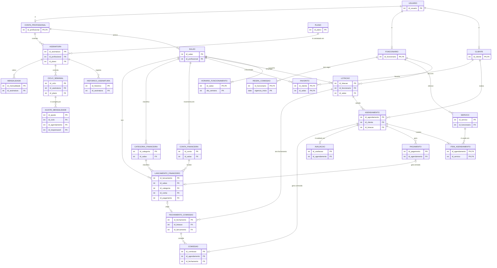

# Modelo lógico — Code e Corte (entrega final)

Este documento é a versão revisada do **DER lógico v2**. Ele parte do DER conceitual (Figma), das correções pedidas na devolutiva da 1ª entrega e dos documentos de correção do grupo (pagamentos, comissões, gestão financeira e mensalidades). O script que implementa tudo isto é [`sql/ddl/01_criar_banco_e_tabelas.sql`](../sql/ddl/01_criar_banco_e_tabelas.sql).

**Notação das tabelas:** `**campo**` (entre asteriscos) = chave primária · `→ TABELA` = chave estrangeira · `UK` = valor único · chave composta entre parênteses.

**Sumário**

1. [Diagrama](#1-diagrama)
2. [Tabelas](#2-tabelas)
3. [Como cada relacionamento do DER virou tabela](#3-como-cada-relacionamento-do-der-virou-tabela)
4. [O que mudou em relação ao DER lógico v2](#4-o-que-mudou-em-relação-ao-der-lógico-v2)
5. [Regras protegidas pelo próprio banco](#5-regras-protegidas-pelo-próprio-banco)
6. [Decisões adotadas a partir dos documentos do grupo](#6-decisões-adotadas-a-partir-dos-documentos-do-grupo)
7. [Inconsistências que ainda precisam ser acertadas](#7-inconsistências-que-ainda-precisam-ser-acertadas)
8. [Pendências de decisão](#8-pendências-de-decisão)

---

## 1. Diagrama



---

## 2. Tabelas

### Pessoas

```text
USUARIO            (**id_usuario**, nome, email UK, telefone, senha_hash, data_cadastro, ativo)
CLIENTE            (**id_cliente** → USUARIO, data_nascimento)
FUNCIONARIO        (**id_funcionario** → USUARIO, cpf UK, especialidade, data_admissao, ativo)
CONTA_PROFISSIONAL (**id_profissional** → USUARIO, cnpj UK)
```

A especialização é parcial e sobreposta. Cada subtipo usa como PK a própria chave estrangeira para `USUARIO`, então o mesmo usuário pode aparecer nas três tabelas e pode não aparecer em nenhuma.

### Unidades e equipe

```text
SALAO                 (**id_salao**, id_profissional → CONTA_PROFISSIONAL, nome, cnpj UK, telefone,
                       cep, logradouro, numero, bairro, cidade, uf, latitude, longitude,
                       ativo, suspenso)
HORARIO_FUNCIONAMENTO (**(id_salao → SALAO, dia_semana)**, hora_abertura, hora_fechamento)
LOTACAO               (**id_lotacao**, id_funcionario → FUNCIONARIO, id_salao → SALAO,
                       data_inicio, data_fim)
SERVICO               (**id_servico**, id_funcionario → FUNCIONARIO, nome, descricao, preco,
                       duracao_min, ativo)
```

- `endereco` e `localizacao` são atributos compostos no DER e viram colunas simples.
- `HORARIO_FUNCIONAMENTO` é entidade fraca: a chave composta `(id_salao, dia_semana)` identifica o horário e já limita a 7 linhas por unidade.
- `LOTACAO` guarda o histórico: cada linha é um período de atuação (`data_fim` vazia = lotação em vigor). Uma transferência fecha uma linha e abre outra.
- `SALAO.suspenso` marca a unidade bloqueada para novos agendamentos por inadimplência. É diferente de `ativo`.

### Agenda, pagamento e avaliação

```text
AGENDAMENTO      (**id_agendamento**, id_cliente → CLIENTE, id_lotacao → LOTACAO,
                  data_hora_inicio, data_hora_fim, status, observacao, criado_em)
ITEM_AGENDAMENTO (**(id_agendamento → AGENDAMENTO, id_servico → SERVICO)**,
                  preco_cobrado, duracao_min)
PAGAMENTO        (**id_pagamento**, id_agendamento → AGENDAMENTO, valor, forma_pagamento,
                  status, data_tentativa, data_aprovacao, motivo_recusa)
AVALIACAO        (**id_avaliacao**, id_agendamento → AGENDAMENTO UK, nota, comentario, data_avaliacao)
FAVORITO         (**(id_cliente → CLIENTE, id_salao → SALAO)**, data_favoritado)
```

`PAGAMENTO` registra cada **tentativa**: recusadas, parciais e a que quita. O total a pagar não é guardado: é a soma de `preco_cobrado` dos itens. Um agendamento está quitado quando a soma dos pagamentos aprovados é igual a esse total.

### Planos e mensalidade da plataforma

```text
PLANO                (**id_plano**, nome UK, preco, limite_semanal, ilimitado, ativo)
ASSINATURA           (**id_assinatura**, id_profissional → CONTA_PROFISSIONAL, id_plano → PLANO,
                      data_inicio, data_renovacao, data_fim, status)
HISTORICO_ASSINATURA (**id_historico**, id_assinatura → ASSINATURA, id_plano_anterior → PLANO,
                      id_plano_novo → PLANO, tipo, valor_diferenca, data_alteracao)
CICLO_SEMANAL        (**id_ciclo**, id_assinatura → ASSINATURA, id_plano → PLANO, semana_inicio,
                      semana_fim, limite_aplicavel, qtd_apurada, status, data_fechamento;
                      UK (id_assinatura, semana_inicio))
AJUSTE_MENSALIDADE   (**id_ajuste**, id_ciclo → CICLO_SEMANAL, id_agendamento → AGENDAMENTO (opcional),
                      tipo, quantidade_anterior, quantidade_corrigida, justificativa,
                      id_responsavel → USUARIO, data_ajuste)
MENSALIDADE          (**id_mensalidade**, id_assinatura → ASSINATURA, ciclo_inicio, ciclo_fim,
                      valor_plano, valor_upgrade, valor_total (calculado), data_vencimento,
                      data_pagamento, forma_pagamento, status, gerada_em;
                      UK (id_assinatura, ciclo_inicio))
```

Valores de domínio carregados pelo script: Inicial (R$ 150,00, 10 clientes por semana), Intermediário (R$ 270,00, 15 por semana) e Ilimitado (R$ 300,00, sem limite).

### Financeiro do salão

```text
CONTA_FINANCEIRA      (**id_conta**, id_salao → SALAO, nome, tipo;  UK (id_salao, nome))
CATEGORIA_FINANCEIRA  (**id_categoria**, id_salao → SALAO, nome, tipo;  UK (id_salao, tipo, nome))
LANCAMENTO_FINANCEIRO (**id_lancamento**, id_salao → SALAO,
                       (id_categoria, id_salao, tipo) → CATEGORIA_FINANCEIRA,
                       (id_conta, id_salao) → CONTA_FINANCEIRA,
                       id_pagamento → PAGAMENTO UK (opcional), descricao, tipo, natureza, valor,
                       vencimento, data_pagamento, status, conferido, boleto_codigo, criado_em)
```

- **Contas a pagar** = lançamentos `SAIDA` pendentes. **Contas a receber** = `ENTRADA` pendentes.
- As chaves compostas garantem que a categoria e a conta são do **mesmo salão** do lançamento e que a categoria é do mesmo tipo (entrada ou saída).
- Cada unidade nasce com um caixa e 13 categorias padrão (11 de despesa e 2 de receita). O dono escolhe a categoria ao lançar o valor.
- `natureza` (fixa ou variável) só existe nas despesas. `boleto_codigo` guarda a linha digitável do boleto gerado.

### Comissões

```text
REGRA_COMISSAO      (**(id_funcionario → FUNCIONARIO, vigencia_inicio)**, vigencia_fim, percentual)
COMISSAO            (**id_comissao**, id_agendamento → AGENDAMENTO UK, id_fechamento → FECHAMENTO_COMISSAO,
                     percentual_aplicado, valor_base, valor_comissao, data_calculo)
FECHAMENTO_COMISSAO (**id_fechamento**, id_lotacao → LOTACAO, id_lancamento → LANCAMENTO_FINANCEIRO UK,
                     mes_referencia, valor_total, data_fechamento, data_pagamento, status;
                     UK (id_lotacao, mes_referencia))
```

### Views

| View | Para que serve |
|---|---|
| `vw_renda_mensal_funcionario` e `vw_renda_mensal_salao` | atributo derivado `renda_mensal` do DER |
| `vw_consumo_semanal` | atendimentos concluídos na semana, saldo do plano e aviso de limite próximo (faltam 2 ou menos) |
| `vw_ciclo_semanal_atualizado` | resultado original do ciclo e resultado depois dos ajustes |
| `vw_fluxo_caixa_mensal` | entradas recebidas, saídas pagas e saldo por mês |
| `vw_contas_a_pagar` e `vw_contas_a_receber` | lançamentos pendentes |
| `vw_pendentes_conferencia` | movimentações realizadas ainda não conferidas com o extrato |

---

## 3. Como cada relacionamento do DER virou tabela

| Relacionamento | Cardinalidade | No modelo lógico |
|---|---|---|
| USUARIO → CLIENTE / FUNCIONARIO / CONTA_PROFISSIONAL | especialização parcial e sobreposta | PK do subtipo = FK para `USUARIO` |
| possui (CONTA_PROFISSIONAL — SALAO) | 1 : N | `SALAO.id_profissional` (NOT NULL) |
| funciona (SALAO — HORARIO_FUNCIONAMENTO) | 1 : (1,7), entidade fraca | PK composta `(id_salao, dia_semana)` |
| trabalha em (FUNCIONARIO — SALAO) | N : N com período | tabela `LOTACAO` |
| oferece (FUNCIONARIO — SERVICO) | 1 : N | `SERVICO.id_funcionario` |
| realiza (CLIENTE — AGENDAMENTO) | 1 : N | `AGENDAMENTO.id_cliente` |
| atende + ocorre em (AGENDAMENTO — FUNCIONARIO — SALAO) | 1 : N | `AGENDAMENTO.id_lotacao` |
| contém (AGENDAMENTO — SERVICO) | N : N com atributos | tabela `ITEM_AGENDAMENTO` |
| gera (AGENDAMENTO — PAGAMENTO) | 1 : N | `PAGAMENTO.id_agendamento` (sem UNIQUE) |
| avalia (AGENDAMENTO — AVALIACAO) | 1 : 0..1 | `AVALIACAO.id_agendamento` com UNIQUE |
| favorita (CLIENTE — SALAO) | N : N | tabela `FAVORITO` |
| contrata (CONTA_PROFISSIONAL — PLANO) | N : N com período | tabela `ASSINATURA` (uma ativa por dono) |
| controla (ASSINATURA — semana) | 1 : N | tabela `CICLO_SEMANAL` |
| é corrigido por (CICLO_SEMANAL — AJUSTE) | 1 : N | `AJUSTE_MENSALIDADE.id_ciclo` |
| cobra (ASSINATURA — MENSALIDADE) | 1 : N | `MENSALIDADE.id_assinatura` |
| tem (SALAO — LANCAMENTO_FINANCEIRO) | 1 : N | `LANCAMENTO_FINANCEIRO.id_salao` |
| gera entrada (PAGAMENTO — LANCAMENTO_FINANCEIRO) | 0..1 : 0..1 | `LANCAMENTO_FINANCEIRO.id_pagamento` com UNIQUE, aceita NULL |
| tem regra (FUNCIONARIO — REGRA_COMISSAO) | 1 : N, entidade fraca | PK composta `(id_funcionario, vigencia_inicio)` |
| gera comissão (AGENDAMENTO — COMISSAO) | 0..1 : 1 | `COMISSAO.id_agendamento` com UNIQUE |
| compõe (FECHAMENTO_COMISSAO — COMISSAO) | 1 : N | `COMISSAO.id_fechamento`, NULL até o fechamento |
| tem fechamento (LOTACAO — FECHAMENTO_COMISSAO) | 1 : N | `FECHAMENTO_COMISSAO.id_lotacao`, UNIQUE com o mês |

---

## 4. O que mudou em relação ao DER lógico v2

Formato pedido pelo manual (etapa 2): o que mudou, como era, como ficou e por quê. A coluna "Devolutiva" indica o item da correção que motivou a mudança.

| # | O que mudou | Como era (v2) | Como ficou | Por que alteramos | Devolutiva |
|---|---|---|---|---|---|
| 1 | Vínculo do funcionário com a unidade | `FUNCIONARIO.(id_profissional, id_salao)`, uma unidade só | tabela `LOTACAO` com `data_inicio` e `data_fim` | Uma transferência apagaria onde o funcionário trabalhava antes. | 1 |
| 2 | Onde o atendimento aconteceu | `AGENDAMENTO.id_funcionario` e `id_profissional, id_salao` | `AGENDAMENTO.id_lotacao` | A lotação já identifica funcionário e unidade. O histórico se preserva e o serviço, o funcionário e a unidade ficam coerentes. | 1 |
| 3 | Conflitos de agenda | verificação só no texto da regra | restrição de exclusão no banco, mais gatilho de horário da unidade | Dois pedidos simultâneos para o mesmo horário não passam, mesmo com concorrência. Férias, feriados e intervalos continuam pendentes. | 2 |
| 4 | Pagamentos | `PAGAMENTO.id_agendamento` único (1:1) | N pagamentos por agendamento, com `data_tentativa`, `data_aprovacao` e `motivo_recusa` | Tentativas recusadas, pagamento parcial e nova tentativa precisam de linhas próprias. | 3 |
| 5 | Valor do pagamento | `valor_total` | `valor` (desta tentativa) | O total passou a ser calculado a partir dos itens, em um só lugar. | 3 |
| 6 | Comissões | não existia | `REGRA_COMISSAO`, `COMISSAO` e `FECHAMENTO_COMISSAO` | O cálculo de comissões estava declarado (P6) e não modelado. O percentual é copiado no cálculo, então reajuste não muda o passado. | 4 |
| 7 | Gestão financeira | não existia | `LANCAMENTO_FINANCEIRO`, `CATEGORIA_FINANCEIRA` e `CONTA_FINANCEIRA` | Cobre contas a pagar, contas a receber, fluxo de caixa e conciliação. | 5 |
| 8 | Mensalidade | `FAIXA_MENSALIDADE` + `MENSALIDADE` por unidade e por clientes distintos no mês | `PLANO`, `ASSINATURA`, `HISTORICO_ASSINATURA`, `CICLO_SEMANAL`, `AJUSTE_MENSALIDADE` e `MENSALIDADE` por assinatura do dono | Adota os planos com limite semanal. A apuração fica preservada por ciclo e as correções viram ajustes. | 6 |
| 9 | Suspensão por inadimplência | `[X]` dias, sem representação | `SALAO.suspenso`, rotina `fn_aplicar_politica_inadimplencia` e reativação ao pagar | Define a política: mais de 15 dias de atraso bloqueiam novos agendamentos, preservando o histórico. | 7 |
| 10 | Chave de SALAO | PK composta `(id_profissional, id_salao)` | PK simples `id_salao` e `id_profissional` como FK | Segue o DER atualizado. Simplifica todas as FKs que apontam para a unidade. | — |
| 11 | CPF | `USUARIO.cpf` único | `FUNCIONARIO.cpf` único | Segue o DER atualizado: só funcionário precisa de CPF. | — |

---

## 5. Regras protegidas pelo próprio banco

| Regra | Como o banco protege |
|---|---|
| E-mail e CPF sem repetição | `UNIQUE` em `usuario.email` e `funcionario.cpf` |
| CNPJ do dono e da unidade únicos | `UNIQUE` + `CHECK` de 14 dígitos |
| Funcionário em uma unidade por vez | `EXCLUDE` em `lotacao` (períodos não podem se sobrepor) |
| Serviço não repete no agendamento | PK composta de `item_agendamento` |
| Serviço é do funcionário que atende | gatilho `fn_valida_item_agendamento` |
| Agendamento dentro da lotação, do horário da unidade e no mesmo dia | gatilho `fn_valida_agendamento` |
| Unidade suspensa ou desativada não recebe novos agendamentos | gatilho `fn_valida_agendamento` |
| Sem conflito de horário do mesmo funcionário | `EXCLUDE` em `agendamento` (ignora cancelados) |
| Pagamento só depois da conclusão; aprovados não passam do total | gatilho `fn_valida_pagamento` |
| Uma avaliação por agendamento concluído, nota de 1 a 5 | `UNIQUE`, `CHECK` e gatilho `fn_valida_avaliacao` |
| Limite semanal do plano (segunda a domingo, atendimentos concluídos) | gatilho `fn_limite_semanal` |
| Uma assinatura ativa por dono | índice único parcial `uq_assinatura_ativa` |
| Troca de plano registrada, upgrade imediato com diferença proporcional | gatilho `fn_assinatura_historico` |
| Ciclo semanal fechado não muda; correção só por ajuste com justificativa e responsável | gatilhos `fn_ciclo_imutavel` e `fn_valida_ajuste`, `CHECK` da justificativa |
| Categoria e conta do lançamento são do mesmo salão e do mesmo tipo | chaves estrangeiras compostas |
| O mesmo recebimento não entra duas vezes | `UNIQUE (id_pagamento)` em `lancamento_financeiro` |
| Cada pagamento gera uma entrada financeira | gatilho `fn_pagamento_gera_lancamento` |
| Movimentação já paga ou recebida não é apagada | gatilho `fn_lancamento_sem_exclusao` |
| Uma regra de comissão vigente por data | `EXCLUDE` em `regra_comissao` |
| Comissão calculada na quitação, recalculada em estorno antes do fechamento | gatilho `fn_pagamento_gera_comissao` |
| Comissão fechada não muda | gatilho `fn_comissao_imutavel` |
| Um fechamento por lotação e mês | `UNIQUE (id_lotacao, mes_referencia)` |

O que o banco **não** consegue impor sozinho e fica na aplicação:
- o mínimo de 1 dia em `horario_funcionamento` (cardinalidade 1,7);
- o mínimo de 1 item por agendamento (1,N);
- o cálculo de `data_hora_fim`;
- o prazo de cancelamento de 2 horas (PO04): o sistema decide entre "cancelado" e "não compareceu" ao registrar o cancelamento;
- a notificação de limite próximo: a view `vw_consumo_semanal` indica quando faltam 2 ou menos, e o envio é da aplicação.

---

## 6. Decisões adotadas a partir dos documentos do grupo

Os documentos se contradiziam em três pontos e o grupo escolheu:

1. **Mensalidade por planos com limite semanal.** O modelo antigo de faixas por clientes distintos no mês foi removido (`FAIXA_MENSALIDADE` e `MENSALIDADE_CLIENTE`).
   - A semana vai de segunda 00:00 a domingo 23:59.
   - Conta cada atendimento **concluído** (não a pessoa única). Cancelamentos e faltas não consomem o limite.
   - O aviso de limite próximo é com 2 atendimentos restantes.
   - O upgrade vale na hora para a semana em andamento e cobra a diferença proporcional aos dias que faltam no mês.
   - A assinatura é do **dono** (conta profissional), não de cada unidade.
2. **Financeiro no modelo do documento** (`LANCAMENTO_FINANCEIRO`, `CATEGORIA_FINANCEIRA`, `CONTA_FINANCEIRA`). Substitui a entidade `contas_pagar` e o atributo composto `categoria` do Figma. As categorias de despesa saem da lista do texto de requisitos, mais "Comissões", "Impostos" e "Marketing".
3. **Comissão no modelo do documento** (`REGRA_COMISSAO`, `COMISSAO`, `FECHAMENTO_COMISSAO`). Substitui o `percentual_comissao` no vínculo e a `COMISSAO` mensal do Figma.

Outras escolhas que seguem o documento de correção de pagamentos e comissões:
- O pagamento só pode ser registrado depois de o agendamento ser concluído, e a tabela não tem `tipo` (sinal ou saldo).
- A lotação do funcionário chama-se `LOTACAO`, como nos documentos.
- A comissão é calculada no atendimento quitado e fechada por mês e por lotação.

---

## 7. Inconsistências que ainda precisam ser acertadas

O SQL segue as decisões da seção 6. O restante do material ainda mostra o desenho anterior. O manual cobra que DER, modelo lógico, dicionário e SQL representem o mesmo projeto, então estes pontos precisam ser atualizados:

**DER conceitual (Figma)**

O arquivo do Figma agora tem o **DER v4**, que segue este modelo e está dividido em quatro módulos mais uma legenda:

1. Usuários e perfis (especialização de `USUARIO`);
2. Unidades, equipe e agenda (`SALAO`, `LOTACAO`, `AGENDAMENTO`, `PAGAMENTO` e outros);
3. Planos e mensalidade (`PLANO`, `ASSINATURA`, `CICLO_SEMANAL` e outros);
4. Financeiro e comissões (`LANCAMENTO_FINANCEIRO`, `REGRA_COMISSAO`, `COMISSAO` e outros).

Entidades de outro módulo aparecem com borda tracejada, só como referência. A legenda traz a notação e as fórmulas dos atributos derivados.

O quadro "DER Chen v3" continua no arquivo apenas como registro da versão anterior e **não vale mais**: ele ainda mostra `contas_pagar`, `MENSALIDADE`, `trabalha em` como (1,1) e `gera` como (0,1). Os quatro módulos do v4 estão exportados em PNG e SVG em [`docs/diagramas/`](diagramas/) e aparecem na seção 16 do [README](../README.md). A versão anterior do DER (1ª entrega original) foi guardada em `docs/versao-anterior/` só como registro.

**Documentos do grupo**
1. **"Políticas organizacionais" e "Resumo — Mensalidades"** ainda descrevem o modelo de faixas (R$ 150, R$ 270 e R$ 350 por clientes distintos, vencimento no dia 10). Precisam ser reescritos para os planos. O resumo também trata o ajuste como diferença em reais compensada no mês seguinte, o que não se aplica a um plano de preço fixo: aqui o ajuste corrige a contagem semanal.
2. **Vencimento da mensalidade:** o documento de planos fala em ciclo mensal a partir da data de contratação, e o de políticas fixa o dia 10. O banco aceita qualquer `data_vencimento`. A regra dos 15 dias de atraso funciona nos dois casos.
3. **Numeração de regras repetida:** RN31, RN34, RN35 e RN36 têm significados diferentes em documentos diferentes (por exemplo, RN31 é "taxas de cobrança" em um e "regra de comissão" em outro). RF13 a RF16 e RN67 a RN74 do documento financeiro também colidem com o README. Precisa de uma numeração única.
4. **O README do repositório não é o PDF v9** que o professor corrigiu: os documentos citam RN27 a RN50 e 14 entidades, e o README tem 25 regras e 12 entidades.
5. **O documento de requisitos financeiros fala em "barbearia"**; os outros falam em "salão". Unificar.
12. O documento de análise de comissões recomendava **não** criar a entidade. O de correção cria três. Vale confirmar com o professor.

---

## 8. Pendências de decisão

| Devolutiva | Pendência |
|---|---|
| 2 | Férias, feriados e intervalos na agenda. Falta decidir se entra uma tabela de bloqueios (por unidade ou por funcionário). |
| 3 | O sinal de 50% (RN27 a RN29 do v9) não está modelado. Se existir, o pagamento precisa de um `tipo` e de regra de perda do sinal. |
| 4 | Estorno depois do fechamento da comissão: o documento admite ajuste manual no fechamento seguinte. Não há tabela para isso. |
| 5 | Conciliação por importação de extrato: hoje é só o campo `conferido`. |
| 7 | Prazo de vencimento definitivo da mensalidade, conforme a seção 7 acima. |
